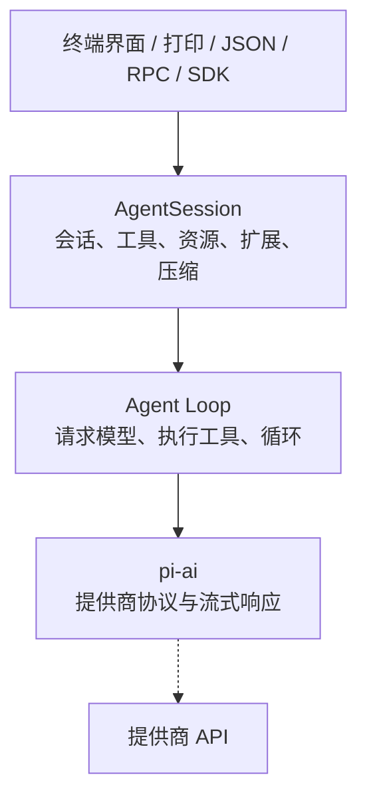
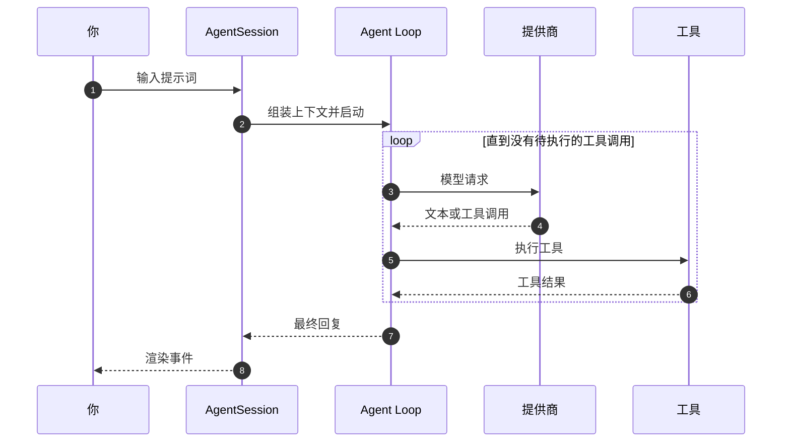

# 第 1 章 认识 Pi

[← 上一章](00-preface.md) · [目录](README.md)

> **本章你将学会**：说清 Pi 是什么、不是什么；理解 Pi 的四个核心概念（会话、分支、回合、上下文）；画出 Pi 的分层架构；描述一次用户请求从输入到回复的完整路径。
>
> **对应官方文档**：[Overview](https://pi.dev/docs/latest) · [How Pi Works](https://pi.dev/docs/latest/how-pi-works) · [Quickstart](https://pi.dev/docs/latest/quickstart)

## 1.1 Pi 解决什么问题

假设你在一个代码仓库里，想让 AI 完成“找出所有未处理的 TODO，按模块汇总，再修掉其中三个简单的”这类任务。聊天窗口里的模型只能看到你粘贴的片段；要让模型真正读文件、跑测试、改代码，需要一个把模型和本机环境连接起来的程序。这类程序通常叫智能体（agent）。

Pi 是一个运行在终端里的智能体运行框架（agent harness）。给它一个目标和一个工作目录，它会：

- 读取目录中的文件和指令；
- 调用模型，让模型决定下一步做什么；
- 执行模型请求的工具调用，例如读文件、搜索、运行命令、编辑文件；
- 把工具结果送回模型，继续下一轮，直到任务完成或你叫停。

它与 IDE 内置助手、网页版聊天机器人的区别在于：Pi 直接在你的终端和文件系统里工作，使用你启动它时的操作系统权限，不依赖图形界面，也不要求你把代码上传到某个托管服务。

## 1.2 Pi 的设计取舍

Pi 的文档反复强调三个取舍，理解它们比记住功能列表更重要。

**核心小，能力外挂。** Pi 内置的工具只有 `read`、`bash`、`edit`、`write`，Windows 上还有 `powershell`；`grep`、`find`、`ls` 等只读工具也可用，但默认不启用。像子智能体（sub-agent）、计划模式（plan mode）这类产品化功能没有内置。需要时，用扩展、技能或现成的 Pi 包加上去。这样做的代价是开箱功能少，收益是行为可预测、定制空间大。

这个取舍不是“少做功能”，而是把功能放在可替换的层。以计划模式为例：如果内置，它会和 Pi 的工具、提示词、快捷键绑定，不喜欢的人只能绕开；作为扩展，它可以自己决定何时进入计划、如何限制工具、如何渲染计划，其他人可以选择不安装。Pi 的仓库里就有 `plan-mode`、`subagent` 等扩展示例，说明这些能力可以在不修改核心的情况下实现。代价是用户需要判断“装哪个、信不信”，而不是打开开关就用。

**默认直接执行，不用每次确认。** Pi 不在每次工具调用前弹窗询问。它把模型输出当作可能出错的内容直接执行，安全边界交给操作系统权限、容器或沙箱，以及你自己对仓库和扩展的审查。官方文档明确说明：Pi 不提供内置的文件系统、进程、网络或凭据权限系统。这一点会在第 6 章展开。

**所有界面共用一套内核。** 终端界面、打印模式、JSON 模式、RPC 模式和 TypeScript SDK 共享同一个智能体循环、会话管理、工具和资源配置。你在终端里看到的行为，换一种接口调用时仍然成立。这让 Pi 既能给人用，也能作为其他程序的引擎。

## 1.3 四个核心概念

**会话（session）。** 会话是 Pi 对一次对话的完整记录，包括用户消息、助手消息、工具调用与结果、模型切换、压缩摘要等事件。会话默认保存在 `~/.pi/agent/sessions/` 下，按工作目录分组，每个会话是一个 JSONL 文件。会话可以在退出后继续，也可以导出或分享。

**分支（branch）。** 会话中的条目通过 `id` 和 `parentId` 组成一棵树。树中从根到某个节点的路径叫分支；当前所在的末端叫叶子（leaf）。发给模型的上下文来自“活动分支”，也就是从根到当前叶子这条路径。回到较早的消息继续提问不会删除原来的路径，而是从那个节点长出一条新分支。这使“换个思路试试”不需要复制整个对话。

一个具体场景：你让 Pi 重构一个模块，它给出了方案 A。你回到“请重构这个模块”那条用户消息，改成“改用依赖注入”，提交后产生方案 B。方案 A 的所有消息仍在会话文件里，但不会进入方案 B 的上下文；你可以在 `/tree` 中来回切换，比较两条路径。只有当你希望两个方案成为独立会话时，才用 `/fork` 或 `/clone`。

**回合（turn）。** 一个回合是一次模型请求加上模型返回的工具调用及其执行结果。一次任务通常包含多个回合：模型读完文件，决定运行测试，测试输出又促使它修改代码。多个回合组成一次智能体运行（agent run）；一次运行结束后，自动重试、压缩后的重试或排队的消息还可能开启下一次运行。因此，判断“Pi 是否真的停了”要看 `agent_settled` 事件，而不是 `agent_end`。

**上下文（context）。** 上下文是下一次模型请求实际携带的内容，包括系统提示词、活动分支转换出的消息、工具定义、技能描述，以及按需加载的技能正文。它不等于会话文件的全部内容：被放弃的分支不进入上下文，被压缩的旧消息由摘要代替。理解“会话记录”和“模型上下文”的区别，是管理长任务的关键。

## 1.4 分层架构

Pi 是一个 monorepo，按职责拆成多个 npm 包。与入门关系最大的是下面几个。

| 包 | 职责 |
|---|---|
| `@earendil-works/pi-tui` | 终端界面库，负责差分渲染、编辑器、组件 |
| `@earendil-works/pi-ai` | 多提供商模型 API，统一 OpenAI、Anthropic、Google 等协议的调用与流式事件 |
| `@earendil-works/pi-agent-core` | 智能体循环、工具调用、状态与事件类型 |
| `@earendil-works/pi-coding-agent` | 编程智能体 CLI，负责会话、工具、资源、扩展、各种运行模式 |
| `@earendil-works/pi-codemode` | 沙箱化 JavaScript 执行，只暴露注入的工具 |
| `@earendil-works/pi-mcp` | 独立的 Model Context Protocol 客户端 |
| `@earendil-works/pi-durable` | 持久化的对话、任务与文档运行时 |
| `@earendil-works/chord` | 可热重载插件与跨进程 RPC 的宿主运行时 |
| `@earendil-works/pi-telemetry` | 厂商中立的遥测契约与参考适配器 |

一次请求大致经过四层：

`AgentSession` 是 coding-agent 的核心对象，拥有一个会话、当前模型、活动工具集、消息队列、压缩状态和扩展运行时。它把上层的界面请求翻译成智能体循环，再把循环产生的事件转成界面能渲染的会话事件。

依赖方向大体是：`coding-agent` 依赖 `agent`、`ai`、`tui`；`agent` 依赖 `ai`；`tui` 相对独立。这个方向很重要：`agent-loop` 不应该知道终端长什么样，`pi-ai` 不应该知道会话文件存在，`SessionManager` 不应该知道模型提供商的协议。修改某一层时，先确认它是否被迫知道了下层或上层的细节；如果答案是否定的，分层就是健康的。

> 源码位置：`packages/coding-agent/src/core/agent-session.ts`（会话生命周期与提示词入口）、`packages/agent/src/agent-loop.ts`（智能体循环）、`packages/coding-agent/src/modes/interactive/interactive-mode.ts`（终端界面）。

## 1.5 一次请求的完整路径

以在终端输入“总结这个仓库的测试方式”为例：

1. 终端界面把输入交给 `AgentSession.prompt()`。如果输入以 `/` 开头，先按斜杠命令或提示词模板处理；如果包含 `@file`，文件内容会作为消息的一部分。
2. Pi 根据活动分支、系统提示词、当前工具和技能描述组装模型请求。系统提示词由基础指令、项目上下文文件、追加指令等分节组成。
3. 请求经 `pi-ai` 发往所选提供商。响应以流的形式返回，可能是文本，也可能包含一个或多个工具调用。
4. 智能体循环执行工具调用。每个内置工具在 `packages/coding-agent/src/core/tools/` 下实现，执行结果写入会话树。工具可以并行执行；修改文件的工具通过逐文件队列避免互相覆盖。
5. 工具结果作为新消息送回模型，进入下一个回合。直到模型不再请求工具、没有排队消息、也没有自动重试，运行结束。
6. 整个过程以事件形式广播：界面渲染文本和工具输出，JSON 模式写成 JSONL，扩展可以监听 `tool_call`、`turn_end` 等事件并干预。

这条路径解释了 Pi 的几个常见现象：为什么工具调用会实时显示、为什么退出后还能继续会话、为什么同一段对话在不同接口下行为一致。

> 源码位置：`packages/coding-agent/src/core/system-prompt.ts`（系统提示词分节与上下文文件）、`packages/coding-agent/src/core/tools/`（内置工具实现）。

## 1.6 Pi 不是什么

- **不是 IDE。** Pi 没有图形编辑器、调试器或项目树。它编辑文件，但是否查看 diff、是否运行测试由你和模型决定。
- **不是沙箱。** 工具和扩展以启动 Pi 的用户权限运行。项目信任只控制是否加载项目资源，不限制工具能访问什么。
- **不是模型。** Pi 需要你提供对某个提供商的访问权：订阅、API Key、云平台凭据或本地模型。
- **不是固定产品。** 没有内置的子智能体、计划模式或权限弹窗；这些通常以扩展或 Pi 包的形式存在。
- **不适合完全图形化的任务。** 它没有代码编辑器的补全、调试器和可视化 diff；这些工作更适合在 IDE 中完成，再把具体任务交给 Pi。
- **不适合无人审查的高风险操作。** 默认不逐次确认，生产环境、部署、数据库变更等操作应加权限扩展、隔离环境或人工审批。

## 1.7 小结

- Pi 是终端中的可扩展智能体运行框架，核心小，能力通过资源与扩展叠加。
- 会话是一棵持久化的条目树，活动分支决定模型看到的历史。
- 回合是一次模型请求及其工具执行；一次运行可能包含多个回合。
- 上下文是会话记录的子集，经过分支选择和压缩处理。
- 终端、打印、JSON、RPC 和 SDK 共用同一套智能体与会话机制。
- Pi 默认直接执行工具，不提供内置沙箱，安全依赖运行环境和你的审查。

## 练习

1. 用一句话向同事解释“Pi 的会话”和“Pi 的上下文”有什么区别。验收：能说出“会话包含所有分支和原始条目，上下文只包含活动分支并可能被压缩”。
2. 画出 Pi 的四层架构，并标出终端界面、`AgentSession`、智能体循环和 `pi-ai` 的位置。验收：不看本章也能画出，且知道每层负责什么。
3. 列出 Pi 默认启用的四个工具，并写出启用 `grep`、`find`、`ls` 的命令。验收：命令能启动 Pi 且这三个工具可用，例如 `--tools read,grep,find,ls`。
4. 解释为什么判断一次运行结束要看 `agent_settled` 而不是 `agent_end`。验收：能举出自动重试或排队消息导致 `agent_end` 之后仍有工作的例子。

## 延伸阅读

- [官方文档：How Pi Works](https://pi.dev/docs/latest/how-pi-works)
- [官方文档：Overview](https://pi.dev/docs/latest)
- 源码：`packages/agent/src/agent-loop.ts`、`packages/coding-agent/src/core/agent-session.ts`、`packages/coding-agent/src/core/session-manager.ts`

---

[目录](README.md) · [下一章 →](02-install.md)
