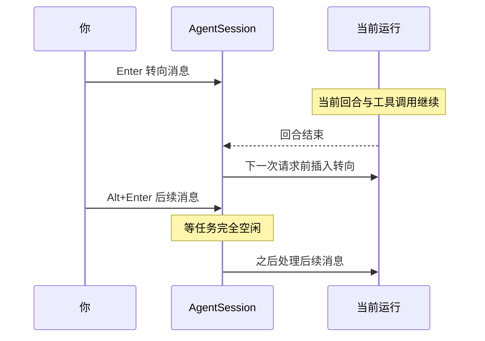

# 第 3 章 终端交互：高效驱动 Pi

[← 上一章](02-install.md) · [目录](README.md)

> **本章你将学会**：用编辑器输入多行提示词和文件引用；在 Pi 工作时调整方向而不打断它；使用 `!` 命令和斜杠命令；复制、导出与分享结果；按习惯修改快捷键。
>
> **对应官方文档**：[Use Pi in the Terminal](https://pi.dev/docs/latest/usage) · [Slash Commands](https://pi.dev/docs/latest/slash-commands) · [Keybindings](https://pi.dev/docs/latest/keybindings)

## 3.1 输入提示词

Pi 的输入区是一个终端编辑器，不是单行输入框。

- `Enter` 发送。
- `Shift+Enter` 换行；部分终端需要额外配置才能上报这个组合，详见官方 Terminal Setup。
- `Ctrl+G` 在外部编辑器中打开当前提示词，适合写长指令。外部编辑器由 `externalEditor` 设置、`$VISUAL` 或 `$EDITOR` 决定。
- 输入 `@` 搜索文件并把路径加入提示词；按 `Tab` 补全路径。
- 粘贴图片，或把图片拖入支持内联图片的终端，图片会作为消息内容的一部分。
- 输入 `!` 开头的内容是 shell 命令，不是发给模型的提示词（见 3.4 节）。

`@` 引用会把文件内容交给模型，而不是只给一个路径。对大文件要有意识：它会计入上下文和费用。选中文件后，编辑器里通常显示为 `@path/to/file`，发送时 Pi 读取内容并附加到消息。

## 3.2 观察 Pi 的工作

Pi 会把每次工具调用和结果展示在对话记录中：

| 按键 | 作用 |
|---|---|
| `Ctrl+O` | 展开或折叠工具输出 |
| `Ctrl+T` | 显示或隐藏思考块（thinking blocks） |
| `Shift+Tab` | 循环切换当前模型支持的思考等级 |
| `Ctrl+L` | 打开模型选择器 |
| `Ctrl+P` | 在已限定的模型范围内循环切换 |
| `Esc` | 中止当前运行 |

状态栏会随模型消耗上下文而更新。编辑器边框反映当前思考等级，启动头部列出本次加载的指令和资源。如果这些信息不符合预期，先检查工作目录和配置，再检查是否加载了项目资源。

## 3.3 在运行中调整方向

Pi 工作时仍然接受输入。三种消息投递方式，加上中止操作，对应四种语义：

| 想做什么 | 操作 | 行为 |
|---|---|---|
| 调整当前任务 | 输入消息按 `Enter` | 等当前助手回复及其工具调用完成后，作为引导消息进入下一回合 |
| 在当前任务后追加工作 | 输入消息按 `Alt+Enter` | 等 Pi 完成当前任务后作为后续消息处理 |
| 把排队消息取回编辑器 | `Alt+Up` | 清空队列，内容回到编辑器 |
| 停止当前任务 | `Esc` | 中止运行，排队消息回到编辑器 |

这就是 Pi 的“转向（steering）”和“后续（follow-up）”机制。它们不是普通的多条消息：转向消息插入在当前助手回合之后、下一次模型请求之前；后续消息要等整个任务空闲后才处理。理解区别可以避免“我明明叫它停，它却先把当前步骤做完”的困惑。

一个例子：Pi 正在运行测试。

- 你发现它用错了测试命令，按 `Enter` 发送“用 `npm test -- --runInBand`，不要跑 e2e”。这条消息会在当前测试命令结束后、下一次模型请求前生效。
- 你想在测试完成后顺便更新文档，按 `Alt+Enter` 发送“测试完成后更新 README 的测试章节”。它会等整个任务结束再处理。
- 你发现它正在修改错误目录，按 `Esc` 立即中止；已经排队的消息回到编辑器，可以修改后重新发送。



> 源码位置：`packages/coding-agent/src/core/agent-session.ts` 的 `steer()`、`followUp()`、`abort()`（消息队列与中止）、`packages/coding-agent/src/modes/interactive/interactive-mode.ts`（按键到队列的映射）。

Windows 和 WSL 上，追加消息用 `Ctrl+Q`，取回队列用 `Alt+Q`。具体以 `/hotkeys` 显示为准。

## 3.4 运行 shell 命令

以 `!` 开头输入命令，命令会立即执行，输出进入对话上下文：

```text
!git status
```

以 `!!` 开头执行命令，但输出不发送给模型：

```text
!!git log --oneline -5
```

适用场景：

- `!` 用于让模型看到结果并据此决策，例如 `!npm test`、`!git diff`。
- `!!` 用于你自己查看信息但不希望影响上下文或费用，例如查看分支、环境变量或敏感输出。

注意，`!` 和 `!!` 命令由你直接发起，不会获得 Pi 注入给模型的会话环境变量（如 `PI_MODEL`、`PI_SESSION_ID`）；这些变量只注入给模型调用的 `bash` 工具。命令本身仍然以你的用户权限执行。

## 3.5 斜杠命令

在编辑器输入 `/` 会打开命令搜索。内置命令按用途分组，最常用的如下。

| 命令 | 用途 |
|---|---|
| `/model [provider/model]` | 选择模型 |
| `/thinking [level]` | 设置思考等级 |
| `/scoped-models` | 配置 `Ctrl+P` 循环使用的模型范围 |
| `/login [provider]`、`/logout` | 管理提供商凭据 |
| `/settings` | 修改常用设置 |
| `/new`、`/resume` | 新建会话、切换会话 |
| `/name [name]` | 给当前会话命名 |
| `/session` | 查看会话文件、ID、消息数、token 与费用 |
| `/tree`、`/fork`、`/clone` | 在会话树中导航、分叉、克隆 |
| `/compact [instructions]` | 压缩上下文，可附带摘要指令 |
| `/copy` | 复制最后一条助手消息 |
| `/export [path]` | 导出为 HTML 或 JSONL |
| `/share` | 上传会话并获取查看链接 |
| `/reload` | 重新加载快捷键、扩展、技能、模板、主题和上下文文件 |
| `/hotkeys` | 查看当前生效的快捷键 |
| `/mcp` | 管理 MCP 服务器 |
| `/trust` | 保存项目信任决定 |
| `/quit` | 退出 |

斜杠命令菜单是当前会话的准确参考：扩展、提示词模板和技能都会向其中添加命令。`/reload` 是修改资源后的常用动作；没有它，新加的模板或扩展不一定立即出现。

命令有四个来源：

| 来源 | 形式 | 处理方式 |
|---|---|---|
| 内置命令 | `/model`、`/settings` 等 | 只在交互模式中处理，不进入智能体 |
| 扩展命令 | `/review`、`/deploy` 等 | 扩展的 `handler` 处理，可带参数补全 |
| 提示词模板 | 文件名即命令名 | 展开为提示词后进入智能体 |
| 技能命令 | `/skill:name` | 加载技能正文并附加参数 |

内置命令与“发给模型的消息”不同。`/model`、`/settings` 这类命令不会作为提示词进入智能体。扩展注册的命令、提示词模板和 `/skill:name` 则会经过输入处理流程，具体顺序见第 9 章。重名时，扩展命令会加数字后缀；模板和技能尽量避免与内置命令同名。

## 3.6 复制、导出与分享

- `Ctrl+X` 或 `/copy`：复制最后一条助手回复。在 `/tree` 中，`Ctrl+X` 复制选中的消息。
- `/export`：把当前会话导出为 HTML 或 JSONL。省略路径时 Pi 自动推导目标文件。
- `/share`：上传会话并返回查看链接。默认在配置了 Radius 认证时使用 Radius 产物，否则通过 GitHub CLI 创建私有 gist；`sessionShareDestination` 设置可以强制选择目的地。

两种导出格式的用途：

- **HTML**：适合阅读、归档和发给同事。保留对话和工具调用的可读排版，不适合程序处理。
- **JSONL**：适合脚本、统计和再次导入。每行一个条目，字段与会话文件一致。

导出和分享前务必审查内容。会话可能包含提示词、工具参数、命令输出、文件内容，以及对话中出现过的凭据。分享链接一旦生成，就应按“已离开本机”处理。若只是想保存一个可继续的副本，用 `--session` 指定文件路径，或直接复制会话 JSONL，不要用 `/share`。

## 3.7 显示模式与终端兼容

Pi 默认使用全屏模式（fullscreen）：编辑器和状态区固定，对话记录在窗口内滚动。常规模式（regular）使用终端自身的回滚缓冲区。可以在 `/settings` 中切换，或用 `--tui-mode` 为单次运行指定：

```bash
pi --tui-mode regular
```

如果遇到渲染问题、快捷键失效或输入法候选框位置异常：

1. 运行 `/hotkeys` 确认绑定是否生效。
2. 查阅官方 Terminal Setup 中对应终端的说明。
3. 运行 `/debug`，Pi 会把渲染行和当前会话消息写入 agent 目录下的 `pi-debug.log`。该文件可能包含敏感内容，分享前先审查。

主题决定颜色。默认的 `system` 主题读取终端的背景色、前景色和 16 个 ANSI 颜色，并按对比度生成 Pi 的配色；终端切换明暗时会重新查询。自定义主题见第 7 章。

全屏模式和常规模式的选择：

- **全屏**：编辑器和状态区固定，适合长时间对话和大量工具输出；滚动由 Pi 接管。
- **常规**：使用终端自身的回滚缓冲区，适合习惯用终端搜索、复制和分屏的用户。

如果终端在两种模式下表现不同，优先排查终端本身对鼠标、扩展键和图片协议的支持，而不是 Pi 的配置。

## 3.8 修改快捷键

快捷键按“动作”命名，例如 `app.session.new`、`app.model.select`。在 `~/.pi/agent/keybindings.json` 中把动作映射到一个键或键数组：

```json
{
  "$schema": "https://pi.dev/schemas/keybindings.schema.json",
  "app.session.new": "ctrl+shift+n",
  "app.session.tree": ["ctrl+shift+t", "alt+shift+t"]
}
```

配置值会替换该动作的默认绑定；空数组表示禁用。修改后运行 `/reload`。键名由修饰键（`ctrl`、`shift`、`alt`、`super`）和键名组成，键名可以是字母、数字、功能键或 `pageUp`、`escape`、`space` 等特殊键。`super` 绑定依赖终端支持 Kitty 键盘协议，不一定在所有终端可用。

> 源码位置：`packages/coding-agent/src/core/keybindings.ts`（默认绑定与解析）、`packages/coding-agent/src/core/slash-commands.ts`（内置命令表）、`packages/coding-agent/src/modes/interactive/interactive-mode.ts`（编辑器与消息队列）。

## 3.9 小结

- `Enter` 发送，`Shift+Enter` 换行，`Ctrl+G` 打开外部编辑器，`@` 引用文件。
- 运行中用 `Enter` 发转向消息，用 `Alt+Enter` 排队后续工作，`Alt+Up` 取回队列，`Esc` 中止。
- `!` 命令的输出进入上下文，`!!` 命令的输出只给你看。
- `/` 菜单是当前会话可用命令的准确来源；`/reload` 用于应用资源改动。
- `Ctrl+X` 复制最后回复，`/export` 导出，`/share` 分享；导出和分享前先审查敏感内容。
- 快捷键可以在 `keybindings.json` 中按动作重绑，`/hotkeys` 查看当前生效值。

## 练习

1. 用 `@` 引用两个文件，让 Pi 比较它们并输出差异摘要。验收：对话记录中能看到文件内容被读取，摘要与文件实际内容一致。
2. 让 Pi 执行一个耗时命令（例如运行测试），在它工作时发送一条转向消息。验收：转向消息在当前工具调用完成后生效，而不是中断当前回合。
3. 用 `!!` 查看一个包含敏感值的环境变量，再用 `!` 执行 `echo hello`。验收：前者输出没有进入模型上下文，后者进入。
4. 用 `/export` 导出当前会话为 HTML，打开文件确认工具调用可读。验收：文件存在，内容包含本次对话。
5. 把 `app.model.select` 改成 `ctrl+shift+l` 并运行 `/reload`，再用 `/hotkeys` 验证。验收：新绑定生效，旧绑定不再触发。
6. 在长对话中运行 `/compact`，然后继续提问。验收：状态栏或 `/session` 显示的上下文用量下降，原始会话文件仍保留旧条目。

## 延伸阅读

- [官方文档：Use Pi in the Terminal](https://pi.dev/docs/latest/usage)
- [官方文档：Slash Commands](https://pi.dev/docs/latest/slash-commands)
- [官方文档：Keybindings](https://pi.dev/docs/latest/keybindings)
- [官方文档：Terminal Setup](https://pi.dev/docs/latest/terminal-setup)
- 源码：`packages/coding-agent/src/modes/interactive/interactive-mode.ts`、`packages/coding-agent/src/core/keybindings.ts`、`packages/coding-agent/src/core/slash-commands.ts`

---

[目录](README.md) · [下一章 →](04-models.md)
