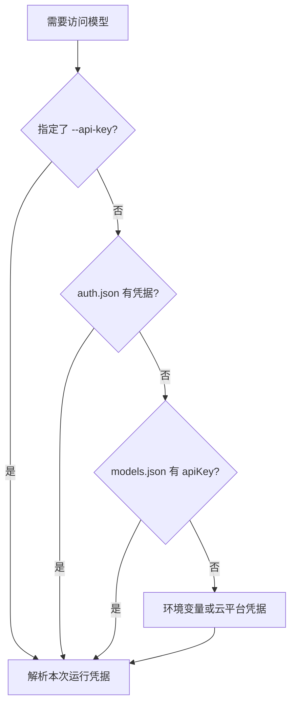

# 第 4 章 模型、提供商与思考等级

[← 上一章](03-terminal.md) · [目录](README.md)

> **本章你将学会**：区分模型与提供商；用 `/login`、环境变量或云平台凭据完成认证；按任务选择模型和思考等级；接入兼容端点、本地模型和自定义提供商。
>
> **对应官方文档**：[Choose a Model](https://pi.dev/docs/latest/models) · [Providers](https://pi.dev/docs/latest/providers) · [Models Configuration](https://pi.dev/docs/latest/models-configuration) · [Local Models with llama.cpp](https://pi.dev/docs/latest/llama-cpp)

## 4.1 模型与提供商

模型是生成回复的那部分，例如某个 Claude、GPT 或 Gemini 模型。提供商是 Pi 访问该模型的服务或账号，例如 Anthropic、OpenAI、Google Vertex AI、OpenRouter，或者你自己运行在 `127.0.0.1:8080` 的 llama.cpp 路由器。

同一个模型可能由多个提供商提供。Pi 的模型引用格式是 `provider/model`，例如 `openai/gpt-5`；如果只写模型名，Pi 会做模糊匹配。多个提供商都提供同一个模型时，Pi 优先选择已有凭据的那个，否则要求你用 `--provider` 明确指定。

Pi 自带一份模型目录，包含提供商、模型 ID、能力、上下文长度和价格。启动时它会尝试叠加 pi.dev 上更新的目录数据；离线时使用缓存。`pi update --models` 强制刷新目录，`--offline` 或 `PI_OFFLINE=1` 禁止启动时的网络访问。模型目录是数据，不是硬编码的行为；同一个模型的能力、价格和上下文长度以目录中的元数据为准。

模型引用有三种常见写法：

- `gpt-5`：模糊匹配模型名。多个提供商都提供时，Pi 优先选择已有凭据的那个。
- `openai/gpt-5`：同时指定提供商和模型，最明确。
- `sonnet:high`：在模型选择中附带思考等级；如果同时传 `--thinking`，后者覆盖这个后缀。

## 4.2 认证的四种方式

按优先级从高到低：

1. 命令行 `--api-key`：只对本次运行生效，不写入磁盘。
2. `~/.pi/agent/auth.json`：通过 `/login` 保存的 API Key 或 OAuth 凭据。
3. `models.json` 中提供商或模型的 `apiKey`。
4. 提供商的环境变量，或云平台的默认凭据（例如 AWS Profile、Google Application Default Credentials）。



交互登录：

```text
/login
```

选择提供商后，Pi 会走该提供商支持的浏览器登录、设备码或 API Key 流程。凭据写入 `auth.json`。`/logout` 删除已保存的凭据，但不会清除环境变量、`models.json` 中的认证，也不会在提供商侧吊销凭据。

远程或无头机器上，OAuth 回调可能无法到达本地进程。按提示把最终的重定向 URL 或授权码粘贴回 Pi。

几种认证方式的取舍：

| 方式 | 优点 | 注意 |
|---|---|---|
| `/login` 保存到 `auth.json` | 多个项目共用，支持 OAuth 和自动刷新 | 文件含密钥，不要提交或共享 |
| 环境变量 | 不落盘，适合 CI 和一次性任务 | 只对启动 Pi 的进程有效，不会自动传递到其他 shell |
| `models.json` 的 `apiKey` | 与自定义端点配置放在一起 | 仍是明文配置，适合占位密钥或受控环境 |
| 云平台默认凭据 | 不直接保存密钥，按云平台权限管理 | 需要正确配置 Profile、角色或 ADC |

## 4.3 用环境变量提供 API Key

CI 和一次性任务适合用环境变量，这样 Pi 不需要写 `auth.json`。常见变量：

| 提供商 | 环境变量 |
|---|---|
| Anthropic | `ANTHROPIC_API_KEY` |
| OpenAI | `OPENAI_API_KEY` |
| Azure OpenAI | `AZURE_OPENAI_API_KEY` 和 `AZURE_OPENAI_BASE_URL` 或 `AZURE_OPENAI_RESOURCE_NAME` |
| Google Gemini | `GEMINI_API_KEY` |
| DeepSeek | `DEEPSEEK_API_KEY` |
| Groq | `GROQ_API_KEY` |
| Mistral | `MISTRAL_API_KEY` |
| xAI | `XAI_API_KEY` |
| OpenRouter | `OPENROUTER_API_KEY` |
| Vercel AI Gateway | `AI_GATEWAY_API_KEY` |
| GitHub Copilot | `COPILOT_GITHUB_TOKEN` |
| Cloudflare Workers AI | `CLOUDFLARE_API_KEY` 和 `CLOUDFLARE_ACCOUNT_ID` |
| Amazon Bedrock | `AWS_PROFILE` 或 `AWS_ACCESS_KEY_ID`/`AWS_SECRET_ACCESS_KEY`，可加 `AWS_REGION` |
| Google Vertex AI | `GOOGLE_CLOUD_API_KEY`，或 `GOOGLE_CLOUD_PROJECT` + `GOOGLE_CLOUD_LOCATION` + ADC |

用法：

```bash
export ANTHROPIC_API_KEY=sk-ant-...
pi
```

变量必须在启动 Pi 的进程里存在。另一个 shell 里设置不会影响已经启动的 Pi。

如果不想把解析后的密钥写到磁盘，可以让 `auth.json` 的 `key` 字段执行一个命令，命令以 `!` 开头：

```json
{
  "anthropic": {
    "type": "api_key",
    "key": "!security find-generic-password -ws 'anthropic'"
  }
}
```

Pi 在首次需要密钥时运行命令，并在进程生命周期内缓存标准输出。空输出、超时或非零退出都会让密钥保持未解析，直到重启。

> 源码位置：`packages/coding-agent/src/core/auth-storage.ts`（凭据存储）、`packages/coding-agent/src/core/runtime-credentials.ts`（运行时凭据解析）。

## 4.4 选择模型

在交互模式中：

- `/model` 打开模型选择器；`Ctrl+L` 是同一入口。
- `Ctrl+S` 在选中的模型上保存为新会话默认模型。
- `Ctrl+P` 在模型范围内循环切换。
- `/scoped-models` 配置循环范围；范围也可以写在 `enabledModels` 设置或 `--models` 参数中。

启动时指定：

```bash
pi --model sonnet:high
pi --model openai/gpt-5
pi --provider openai --model gpt-5
```

`--model` 支持精确 ID、模糊匹配、`provider/id` 和可选的 `:<thinking>` 后缀。`--provider` 只能与 `--model` 一起使用，用于在两个提供商都提供同名模型时限定查找范围。

限定循环范围：

```bash
pi --models sonnet:high,haiku:low
pi --models "anthropic/*"
```

列出可用模型后退出：

```bash
pi --list-models sonnet
```

模型目录会变化，`/model` 只显示当前有可用认证的模型。模型不出现时，先确认提供商的凭据可用；兼容端点还要确认 `models.json` 已加载且认证可解析。

按任务选择模型的参考：

| 任务 | 选择倾向 |
|---|---|
| 机械改写、格式转换、简单问答 | 小模型、低思考等级、低费用 |
| 日常编码、排查、写测试 | 中等规模模型，`medium` 思考等级 |
| 跨文件重构、架构设计、疑难缺陷 | 强模型，`high` 或更高思考等级 |
| 大批量分类、筛选、路由 | 分类器模型，经 Codemode 调用 |
| 图像生成或编辑 | 图像模型，经 Codemode 调用 |

不确定时，先用默认模型完成一次任务，再根据输出质量、耗时和费用调整。频繁切换模型会丢失提示缓存，长任务中应尽量保持同一模型。

## 4.5 思考等级

思考等级（thinking level）控制模型在回答前投入多少推理。Pi 支持 `off`、`minimal`、`low`、`medium`、`high`、`xhigh`、`max` 七个等级，默认 `medium`。不同模型支持的范围不同，Pi 会把请求的等级限制到模型能力之内。

设置方式：

```text
/thinking high
```

或启动时：

```bash
pi --thinking high
```

`Shift+Tab` 循环切换；在 `/thinking` 选择器中按 `Ctrl+S` 保存为启动默认值。每个模型还可以通过 `thinkingBudgets` 设置不同等级对应的 token 预算，通过 `modelThinkingLevels` 设置按模型区分的启动等级。

选择建议：

- `off` 或 `minimal`：格式转换、简单问答、机械修改。
- `medium`：日常编码和排查。
- `high` 及以上：跨文件重构、复杂设计、难以复现的缺陷。

思考内容会显示为独立的思考块，`Ctrl+T` 可以隐藏或显示。思考块计入输出 token，长任务中提高思考等级会明显增加费用。

## 4.6 兼容端点

如果服务实现了 OpenAI、Anthropic 或 Google 兼容 API，优先用 `models.json` 接入，而不是写扩展。文件位于 `~/.pi/agent/models.json`。以 Ollama 为例：

```json
{
  "$schema": "https://pi.dev/schemas/models.schema.json",
  "providers": {
    "ollama": {
      "baseUrl": "http://localhost:11434/v1",
      "api": "openai-completions",
      "apiKey": "ollama",
      "models": [
        { "id": "qwen2.5-coder:7b" }
      ]
    }
  }
}
```

Ollama 会忽略这个占位密钥，但 Pi 需要它来判断提供商可用。认证值支持 `$NAME`、`${NAME}` 环境变量插值，也支持以 `!command` 开头的命令。

只把内置提供商指向代理时，提供一个 `baseUrl` 即可，模型列表和认证保持不变：

```json
{
  "providers": {
    "anthropic": { "baseUrl": "https://proxy.example.com/v1" }
  }
}
```

打开 `/model` 会重新加载 `models.json`。`models` 数组会添加或替换同一提供商下同 ID 的模型；`modelOverrides` 只修改已有模型的元数据，不替换模型列表。

自定义模型最常用的字段：

| 字段 | 作用 |
|---|---|
| `id` | 模型 ID，调用时使用 |
| `name` | 选择器中显示的名称 |
| `reasoning` | 是否支持思考/推理 |
| `input` | `["text"]` 或 `["text", "image"]` |
| `contextWindow` | 上下文窗口 token 数 |
| `maxTokens` | 单次最大输出 token 数 |
| `cost` | 输入、输出、缓存读写价格 |
| `api` | 协议类型，例如 `openai-completions` |

`contextWindow` 和 `maxTokens` 影响压缩和请求参数；`cost` 影响 `/session` 和状态栏的费用统计。填错这些值不会阻止请求，但会让压缩时机或费用显示失真。

## 4.7 本地模型

Pi 直接支持 llama.cpp 的路由模式（router mode）。路由器可以发现多个 GGUF 模型，并按需加载或卸载。

```bash
llama serve \
  --no-models-autoload \
  --jinja \
  --host 127.0.0.1 \
  --port 8080 \
  -ngl all \
  -c 32768
```

`--no-models-autoload` 让加载保持显式；`--jinja` 启用兼容的聊天模板和工具调用。然后在 Pi 中：

```text
/login llama.cpp
```

输入路由器 URL（默认 `http://127.0.0.1:8080`）和可选 API Key。若路由器没有自动加载模型，先运行 `/llama` 加载模型，再用 `/model` 选择。环境变量方式：

```bash
export LLAMA_BASE_URL=http://127.0.0.1:8080
export LLAMA_API_KEY=optional-secret
pi
```

`/llama` 还可以从 Hugging Face 搜索并下载模型。Pi 不会静默卸载其他模型，也不会删除模型文件。

## 4.8 自定义提供商与虚拟模型

当服务需要自定义认证流程、动态发现模型或非标准流式协议时，用扩展注册提供商：

```typescript
import type { ExtensionAPI } from "@earendil-works/pi-coding-agent";

export default function (pi: ExtensionAPI) {
  pi.registerProvider("acme", {
    name: "Acme AI",
    baseUrl: "https://api.acme.example/v1",
    apiKey: "$ACME_API_KEY",
    api: "openai-completions",
    models: [
      {
        type: "chat",
        id: "acme-chat",
        name: "Acme Chat",
        reasoning: false,
        input: ["text"],
        cost: { input: 0, output: 0, cacheRead: 0, cacheWrite: 0 },
        contextWindow: 128000,
        maxTokens: 8192,
      },
    ],
  });
}
```

虚拟模型（virtual model）是另一类扩展：它在 `/model` 中像普通模型一样可选，但每次请求时由路由器决定实际调用哪个物理模型。典型用途是按任务难度、费用或对话状态分流。虚拟模型记录在 `model_change` 条目中，每条助手消息仍然记录实际回答的物理模型。

> 源码位置：`packages/coding-agent/src/core/model-registry.ts`（模型注册与查找）、`packages/coding-agent/src/core/provider-composer.ts`（提供商组装）、`packages/coding-agent/src/core/virtual-models.ts`（虚拟模型路由）。

## 4.9 费用、上下文与模型切换

状态栏显示当前上下文用量和累计费用。`/session` 给出更完整的会话统计：文件、ID、消息数、各模型的 token 用量和费用。费用按模型目录中的 `cost` 计算；自定义模型如果没有价格，费用会显示为零或不完整。

模型切换会写入会话的 `model_change` 条目。恢复会话时，Pi 恢复最近一次选择，而不是启动时的默认模型。助手消息还会记录实际回答的提供商和模型，因此同一个会话可以跨模型继续，回放时仍能知道每条回复由谁生成。

切换模型时要注意：

- 新模型的上下文窗口可能更小，Pi 会在下一次请求前检查并可能触发压缩。
- 不同模型的思考等级支持范围不同，Pi 会把等级限制到可用范围。
- 频繁切换会破坏提示缓存；长任务中尽量保持同一模型和稳定的系统提示词。
- 费用和 token 统计按实际提供商返回的 usage 累加；流式过程中未返回 usage 时，状态栏可能暂时为零。

如果使用支持长缓存的提供商，可以设置 `PI_CACHE_RETENTION=long` 请求更长的缓存保留时间；模型本身必须声明缓存生命周期，否则该设置不会产生效果。缓存预热由 `cacheWarming` 设置控制，默认 `streaming`，只在预计节省的费用超过阈值时运行。

## 4.10 小结

- 模型负责生成，提供商负责访问；同一模型可能有多个提供商。
- 认证优先级为 `--api-key`、`auth.json`、`models.json`、环境变量或云平台凭据。
- 用 `/model` 选择模型，`/thinking` 选择思考等级；`Ctrl+S` 保存默认值。
- 兼容端点优先写 `models.json`；需要自定义认证或协议时才写提供商扩展。
- llama.cpp 路由器通过 `/login llama.cpp` 和 `/llama` 管理。
- 虚拟模型把“用户选择的模型”和“实际调用的模型”分开。

## 练习

1. 用 `/model` 选择一个模型，用 `Ctrl+S` 保存为默认，重启 Pi 验证。验收：新会话的默认模型与保存值一致。
2. 用环境变量提供 API Key，启动一个不写入 `auth.json` 的会话。验收：`/session` 能正常工作，`auth.json` 中没有新增该提供商的凭据。
3. 在 `models.json` 中添加一个 Ollama 兼容端点，用 `/model` 选中它并完成一次对话。验收：请求到达本地端点，模型出现在选择器中。
4. 分别用 `low` 和 `high` 思考等级解决同一个复杂问题，比较耗时和输出。验收：能说明思考等级对 token 用量或响应时间的影响。
5. 阅读一个提供商扩展示例，指出它比 `models.json` 多做了什么。验收：能说出至少一项 `models.json` 无法表达的行为，例如动态模型发现或自定义认证。

## 延伸阅读

- [官方文档：Choose a Model](https://pi.dev/docs/latest/models)
- [官方文档：Providers](https://pi.dev/docs/latest/providers)
- [官方文档：Models Configuration](https://pi.dev/docs/latest/models-configuration)
- [官方文档：Local Models with llama.cpp](https://pi.dev/docs/latest/llama-cpp)
- [官方文档：Custom Providers](https://pi.dev/docs/latest/custom-provider)
- [官方文档：Virtual Models](https://pi.dev/docs/latest/virtual-models)
- 源码：`packages/coding-agent/src/core/model-registry.ts`、`packages/coding-agent/src/core/provider-composer.ts`、`packages/coding-agent/src/core/virtual-models.ts`、`packages/coding-agent/src/extensions/llama/`

---

[目录](README.md) · [下一章 →](05-sessions.md)
