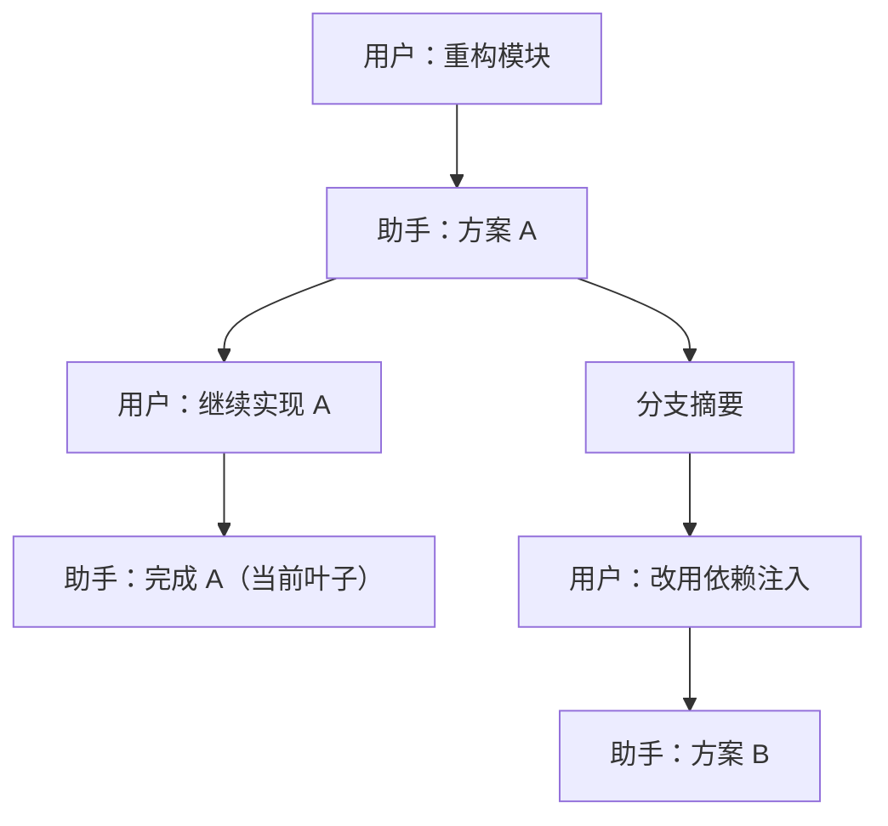
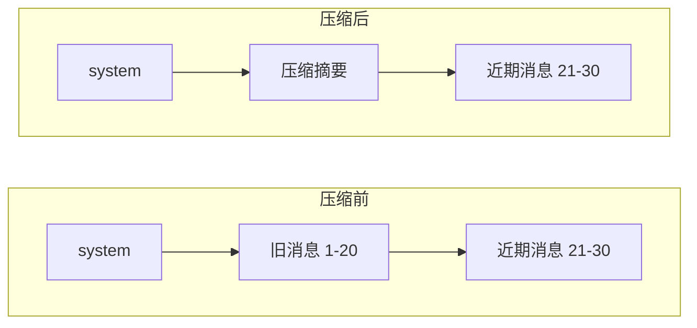

# 第 5 章 会话、分支与上下文管理

[← 上一章](04-models.md) · [目录](README.md)

> **本章你将学会**：继续和切换会话；用会话树、分叉和克隆探索不同方案；读懂会话文件的树结构；用压缩控制上下文大小；控制会话存储位置并安全导出。
>
> **对应官方文档**：[Manage Sessions and Context](https://pi.dev/docs/latest/sessions) · [Session File Format](https://pi.dev/docs/latest/session-format) · [Compaction Reference](https://pi.dev/docs/latest/compaction)

## 5.1 会话是什么样子的

会话是 Pi 对一次对话的持久化记录。默认情况下，每个会话是一个 JSONL 文件，位于：

```text
~/.pi/agent/sessions/--<path>--/<timestamp>_<session-id>.jsonl
```

`<path>` 由工作目录转换而来：去掉开头的路径分隔符，把 `/`、`\` 和 `:` 替换为 `-`。因此同一目录下的会话会归到同一个子目录。

文件第一行是会话头，记录版本、会话 ID、时间戳和工作目录：

```json
{"type":"session","version":3,"id":"uuid","timestamp":"2024-12-03T14:00:00.000Z","cwd":"/path/to/project"}
```

之后每一行是一个条目，共有 `id` 和 `parentId` 字段。两者把条目连成一棵树：`parentId` 为 `null` 的是根，当前所在的条目叫叶子。发给模型的历史是“从根到当前叶子”的这条路径，也就是活动分支。其他分支留在文件里，但不进入模型上下文。

条目类型包括：用户/助手/工具结果消息、模型切换、思考等级切换、压缩摘要、分支摘要、扩展自定义条目、标签、会话命名等。完整定义见官方 Session File Format。

一个会话树可能长这样：



两条分支共享前面的历史；只有从根到当前叶子的路径会进入模型上下文。旧分支不会因为切换而消失，仍可通过 `/tree` 回去。

## 5.2 继续、切换与命名

会话默认自动保存，除非用 `--no-session` 启动。退出后：

```bash
pi --continue
```

打开当前工作目录最近的会话；`pi --resume` 或交互模式中的 `/resume` 打开会话选择器，可以搜索、重命名、删除会话，切换排序或只显示已命名会话。

常用命令：

| 命令 | 作用 |
|---|---|
| `/new` | 开始新会话 |
| `/resume` | 切换到其他已保存会话 |
| `/name [name]` | 设置或查看会话显示名 |
| `/session` | 查看会话文件、ID、消息数、token 用量和费用 |
| `/import <path>` | 导入并继续一个 JSONL 会话 |

会话名会显示在会话选择器中，代替第一条用户消息。命名长任务，例如“重构鉴权模块”，比记住会话 ID 实用得多。

> 源码位置：`packages/coding-agent/src/cli/session-picker.ts`（搜索、重命名、删除会话）、`packages/coding-agent/src/core/agent-session.ts`（继续、切换与命名）。

## 5.3 分支、分叉与克隆

Pi 提供三种“换一条路走”的方式，区别在于结果落在哪里。

| 操作 | 结果 | 适用场景 |
|---|---|---|
| `/tree` | 在当前会话文件内移动叶子 | 相关方案应该放在一起比较 |
| `/fork` | 从较早的用户消息创建新会话 | 备选方案应该成为独立工作 |
| `/clone` | 把当前活动分支复制成新会话 | 想要当前状态的独立副本 |

**在会话树中导航。** 运行 `/tree` 打开树浏览器。选中一条用户消息，Pi 会把它放回编辑器；修改后提交，就从该节点长出一条新分支。选中助手回复或其他条目，则从该条目之后继续，编辑器为空。

离开一条分支时，Pi 可以生成该分支的摘要并附到新进入的分支上，让你保留被放弃路径中的关键结论，而不必把所有消息都带进上下文。摘要行为可以通过 `branchSummary` 设置调整；`skipPrompt` 设为 `true` 时跳过询问并默认不生成摘要。

**分叉。** `/fork` 从选中的用户消息创建一个新会话文件，原会话不变。适合“我想保留原方案，另开一个完全独立的尝试”。之后两个会话可以分别命名、分别导出。

**克隆。** `/clone` 把当前活动分支复制到新会话，等于在当前状态按下一个“另存为”。适合在稳定状态下做实验，失败后直接回到原会话。

命令行也能完成这些操作：

```bash
pi --fork <path|id>
pi --session <path|id>
pi --session-id <id>
```

`--session` 接受文件路径、精确 ID 或部分 ID；`--session-id` 打开精确的项目会话 ID，不存在则创建。`--fork` 不能与 `--session`、`--continue`、`--resume` 或 `--no-session` 同时使用。

## 5.4 上下文如何组装

模型看到的不是整个会话文件，而是：

1. 系统提示词：基础指令、项目上下文文件、追加指令等分节内容。
2. 活动分支中的消息：用户消息、助手消息、工具结果，按树路径选出。
3. 工具定义：当前启用的工具及其参数 schema。
4. 技能描述：每个技能的 name、description 和路径；正文按需加载。

此外，扩展可以在请求发出前修改消息、注入自定义消息或替换系统提示词。提示词模板在进入智能体之前展开，`@file` 文件内容作为消息内容附加。

因此，“会话里有多少消息”和“模型这次看到多少 token”不是一回事。放弃的分支不计入，压缩会替换旧消息，技能正文只在需要时读取。

可以用一个粗略的预算来理解一次请求：

| 组成 | 是否每次都发送 | 说明 |
|---|---|---|
| 系统提示词 | 是 | 基础指令、规则、上下文文件、技能索引 |
| 工具定义 | 是 | 当前启用的工具及其参数 schema |
| 活动分支消息 | 是 | 按树路径选出，压缩后由摘要替代旧消息 |
| 技能正文 | 否 | 模型判断需要时才读取 |
| 被放弃的分支 | 否 | 只留在会话文件中 |
| 图片 | 视消息而定 | 受模型输入能力和图片大小限制 |

长任务中，系统提示词和工具定义是固定开销；历史消息和工具输出是主要增长来源。减少一次性读取的大文件，往往比反复压缩更有效。

> 源码位置：`packages/coding-agent/src/core/session-manager.ts` 中的 `buildContextEntries()` 与 `buildSessionContext()` 定义了活动分支选择、压缩边界和条目到消息的转换。

## 5.5 压缩上下文

当活动上下文接近模型上限时，Pi 通常会自动压缩。默认触发条件是：

```text
contextTokens > contextWindow - reserveTokens
```

`reserveTokens` 默认 16384，`keepRecentTokens` 默认 20000。前者决定何时开始压缩，后者决定保留多少近期内容不总结。两者都可以在 `settings.json` 的 `compaction` 下调整，也可以按模型覆盖。

压缩过程：

1. 从当前投影向回累计 token，找到保留边界。
2. 收集边界之前的消息，调用模型生成结构化摘要。
3. 追加一条 `compaction` 条目，记录摘要、`firstKeptEntryId` 和压缩前的 token 数。
4. 之后组装上下文时，用摘要代替边界之前的消息，保留边界之后的消息。

原始条目不会被删除。`/tree`、导出和原始会话文件仍然能看到完整历史；只是模型上下文里用摘要替换了旧消息。

压缩前后的模型视角：



会话文件中仍然是 1..30 加上一条 `compaction` 条目。`firstKeptEntryId` 指向消息 21，决定从哪里开始保留原文。重复压缩时，新的摘要会从上次压缩的保留边界开始收集消息，并把上次摘要作为迭代上下文，而不是把压缩条目本身当作新起点。

手动压缩：

```text
/compact
/compact 保留所有与数据库迁移有关的决定
```

可选指令会指导摘要保留特定主题。压缩可能因提供商不可用或无法接受摘要请求而失败；修复提供商问题后重试。关闭自动压缩（`compaction.enabled: false`）不会禁用 `/compact`。

压缩检查发生在两个位置：新用户提示词之前，以及多回合任务中工具结果追加之后、下一次模型请求之前。提供商报上下文溢出或模型因长度停止时，Pi 还可能执行一次“压缩后重试”的恢复流程。

## 5.6 控制会话存储

优先级从高到低：

1. `--session-dir <dir>`
2. 环境变量 `PI_CODING_AGENT_SESSION_DIR`
3. `settings.json` 中的 `sessionDir`
4. 默认的 agent 会话目录

其他相关参数：

- `--no-session`：使用内存会话，不持久化，退出后无法继续。
- `--session-dir`：同时改变存储和查找位置。
- `--session` / `--session-id`：按路径或 ID 打开；`--session-id` 还会在不存在时创建。
- `--fork`：交互模式启动前从已有会话分叉。

会话目录还受“项目信任”的一个例外影响：`sessionDir` 是唯一在信任决定之前读取的项目设置，因为 Pi 需要先找到会话。因此不信任的项目仍然可能影响会话目录的选择，这一点在第 6 章的安全部分会再说明。

## 5.7 导出与分享

`/export` 把当前会话写成 HTML 或 JSONL；`/share` 上传并返回查看链接。分享目的地由 `sessionShareDestination` 控制：`auto` 在配置了 Radius 认证时使用 Radius，否则创建 GitHub gist；`gist` 和 `radius` 强制指定，`radius` 不会回退到 gist。

导出或分享前检查：

- 是否包含 API Key、token、内部 URL 或客户数据；
- 是否包含工具读取的敏感文件内容；
- 是否包含扩展注入的内部消息。

会话是完整记录，不只是你看到的回复。把它当作可能泄露全部上下文的文件来处理。

## 5.8 手工检查会话文件

会话是普通 JSONL，可以用 `jq` 检查。统计条目类型：

```bash
jq -r '.type' ~/.pi/agent/sessions/--path-to-project--/*.jsonl | sort | uniq -c
```

示例输出：

```text
   1 session
  42 message
   3 model_change
   1 compaction
   2 custom
```

查看消息树的关键字段：

```bash
jq -c 'select(.type == "message") | {id, parentId, role: .message.role}' session.jsonl
```

查看压缩边界：

```bash
jq -c 'select(.type == "compaction") | {id, firstKeptEntryId, tokensBefore}' session.jsonl
```

这些检查适合排查“为什么恢复了错误的模型”“为什么上下文没有变小”“某个扩展状态是否写入”等问题。会话文件可能包含敏感内容，检查后不要随意粘贴到公开渠道。

## 5.9 小结

- 会话是 JSONL 文件中的条目树，活动分支决定模型历史；`--continue` 继续最近会话，`--resume` 打开选择器。
- `/tree` 在文件内换分支，`/fork` 和 `/clone` 创建新会话；`/name` 和 `/session` 用于识别会话。
- 上下文由系统提示词、活动分支、工具定义和技能描述组成，不等于完整会话。
- 自动压缩在上下文接近上限时触发，摘要替换旧消息但原始条目保留。
- 会话目录的优先级为 CLI 参数、环境变量、设置、默认目录。
- 导出和分享前必须审查敏感内容。

## 练习

1. 运行 `/session`，记录当前会话的文件路径和 ID；退出后用 `pi --continue` 继续，再次运行 `/session` 核对。验收：两次 ID 相同，文件路径存在。
2. 用 `/tree` 回到一条用户消息，修改后提交，形成新分支。验收：`/tree` 中能看到两条从同一节点分出的路径，旧路径仍可访问。
3. 用 `/fork` 创建一个新会话，分别命名两个会话。验收：`/resume` 中显示两个独立会话，修改互不影响。
4. 在长对话中手动 `/compact`，然后查看会话 JSONL。验收：文件中有 `compaction` 条目，且原始消息条目仍然存在。
5. 用 `--no-session` 启动，完成一次对话后退出，再运行 `pi --continue`。验收：无法恢复该次对话，说明会话未被持久化。
6. 用 `/export session.jsonl` 导出会话，再用 `jq` 统计条目类型。验收：至少能看到 `session` 头和若干 `message` 条目；如果会话压缩过，能说出一条 `compaction` 条目的 `firstKeptEntryId` 含义。

## 延伸阅读

- [官方文档：Manage Sessions and Context](https://pi.dev/docs/latest/sessions)
- [官方文档：Session File Format](https://pi.dev/docs/latest/session-format)
- [官方文档：Compaction Reference](https://pi.dev/docs/latest/compaction)
- 源码：`packages/coding-agent/src/core/session-manager.ts`、`packages/coding-agent/src/core/compaction/compaction.ts`、`packages/coding-agent/src/core/agent-session.ts`

---

[目录](README.md) · [下一章 →](06-configuration.md)
