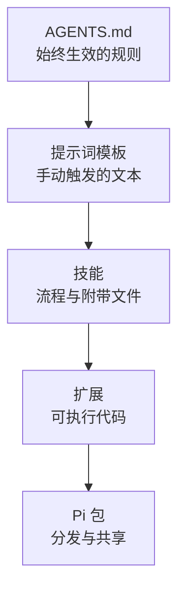
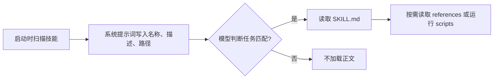

# 第 7 章 用资源定制 Pi

[← 上一章](06-configuration.md) · [目录](README.md)

> **本章你将学会**：判断一个问题该用 `AGENTS.md`、提示词模板、技能还是扩展；写出带参数的提示词模板；用 `SKILL.md` 打包按需加载的流程；选择或自定义主题；把多个资源打包成 Pi 包并安装。
>
> **对应官方文档**：[Create Prompt Templates](https://pi.dev/docs/latest/prompt-templates) · [Add Skills](https://pi.dev/docs/latest/skills) · [Create Themes](https://pi.dev/docs/latest/themes) · [Use Pi Packages](https://pi.dev/docs/latest/packages)

## 7.1 选择最轻的机制

Pi 的定制手段从轻到重排列如下：

| 需求 | 首选机制 |
|---|---|
| 让 Pi 在这个目录里始终遵守某些规则 | `AGENTS.md` |
| 复用一段常用提示词 | 提示词模板 |
| 给某类任务一套流程和辅助文件 | 技能 |
| 增加可执行工具、命令或事件处理 | 扩展 |
| 改变终端颜色 | 主题 |
| 打包并分发以上多种资源 | Pi 包 |
| 接入外部工具服务 | MCP 服务器 |

判断原则：能用文本解决就不写代码；能用按需加载的技能解决就不写常驻扩展。扩展运行在 Pi 进程内，拥有完整权限，成本和风险都最高。



MCP 是另一条轴：它接入外部工具服务，不与上面的“轻到重”顺序直接对应。选择时先问“需要外部工具，还是需要本地规则/流程/代码”，再在对应轴上选最轻的机制。

一个具体例子：团队希望每次提交前都检查“错误处理、测试、变更日志”。先写进 `AGENTS.md` 就够；如果希望手动触发，把它做成提示词模板；如果还需要附上检查清单和历史案例，做成技能；只有需要自动运行命令、读取 git 状态或阻止提交时，才写扩展。

反过来，如果需求是“每次读取 `.env` 时都阻止”，`AGENTS.md` 和模板都不可靠，因为模型可能忘记遵守；这必须在扩展的 `tool_call` 事件里做强制拦截。判断标准不是“哪个更简单”，而是“这个约束必须由模型自觉遵守，还是必须由代码强制执行”。

## 7.2 提示词模板

提示词模板把 Markdown 文件变成斜杠命令。文件名就是命令名。创建 `~/.pi/agent/prompts/review.md`：

```markdown
---
description: Review staged git changes
argument-hint: "[focus]"
---
Review the staged changes. Focus on ${1:-correctness, security, and error handling}.
```

在 Pi 中：

```text
/review
/review concurrency
```

模板支持的替换：

| 语法 | 结果 |
|---|---|
| `$1`、`$2`、… | 第 N 个位置参数 |
| `$@` 或 `$ARGUMENTS` | 所有参数，用空格连接 |
| `${1:-default}` | 第一个参数，或默认值 |
| `${@:-default}` | 所有参数，或默认值 |
| `${@:N}` | 从第 N 个开始的参数 |
| `${@:N:L}` | 从第 N 个开始的 L 个参数 |

参数按类 shell 规则分词，所以 `/review "API compatibility"` 只提供一个含空格的参数。

frontmatter 中：

- `description` 显示在命令补全里；省略时用第一行非空文本。
- `argument-hint` 只影响提示，不参与校验；用 `<尖括号>` 表示必填，`[方括号]` 表示可选。
- 模板正文就是展开后的提示词，可以引用项目路径、要求输出格式或列出检查步骤。

模板在进入智能体之前展开。扩展会先通过 `input` 事件看到原始输入，除非同名扩展命令已经处理。项目模板在项目被信任后才会成为命令。添加或修改模板后运行 `/reload`。

模板只适合“一段固定文本加参数”。需要附带脚本、参考资料或多个步骤时，用技能。模板也没有强制力：它只是把一段文本放进对话，模型仍可能不遵守其中的要求。

## 7.3 技能

技能（skill）是一个包含 `SKILL.md` 的目录，可以附带脚本、参考文档和资源。Pi 在启动时只把技能的 name、description 和路径放进系统提示词；模型判断任务匹配后，才读取完整指令。这叫渐进式披露，目的是不把长指令常驻在上下文里。

目录示例：

```text
pdf-tools/
├── SKILL.md
├── scripts/
│   └── extract.sh
├── references/
│   └── formats.md
└── assets/
    └── template.json
```

`SKILL.md` 开头是 frontmatter，后面直接写指令：

```markdown
---
name: pdf-tools
description: Extract text and tables from PDF files. Use when reading, converting, or inspecting PDFs.
---

# PDF tools

Read `references/formats.md` before converting a document. Run scripts relative to this skill directory.
```

`description` 决定模型何时考虑加载技能，必须同时说明“做什么”和“什么时候用”。只写“帮助处理 PDF”不足以让模型做出正确路由。引用附带文件时用相对技能目录的路径，Pi 会告诉模型技能所在位置。

加载过程可以分成三步：

1. 启动时，Pi 扫描技能位置，把每个技能的 name、description 和路径加入系统提示词。此时不读取正文。
2. 模型判断任务匹配后，用 `read` 或 `bash` 读取 `SKILL.md`，再按其中的指令读取附带文件。
3. 你也可以用 `/skill:name` 强制加载，参数会附加到指令后面。



因此，技能的成本主要发生在使用时，而不是启动时。但技能索引本身仍占用系统提示词空间；技能很多时，应把 description 写得短而具体。

加载位置：

- `~/.pi/agent/skills/`：用户级，所有项目可用；
- `.pi/skills/`：项目级，信任后加载；
- `~/.agents/skills/` 和 `.agents/skills/`：Agent Skills 规范位置；
- 设置或 Pi 包中声明的路径。

包含 `SKILL.md` 的目录会被递归发现。名称用小写字母、数字和连字符，最长 64 字符；描述最长 1024 字符。格式错误或没有描述的技能不会加载；同名技能保留第一个发现并给出警告。

手动强制加载：

```text
/skill:pdf-tools extract report.pdf
```

命令后的参数会附加到技能指令之后。若技能只应由手动命令触发，在 frontmatter 中写 `disable-model-invocation: true`。`enableSkillCommands` 设置控制技能命令是否出现在命令发现中，但手动输入 `/skill:name` 始终有效。

技能可以分发为 Pi 包。审查第三方技能时要注意，它可能指示模型运行脚本或修改文件。

## 7.4 主题

Pi 内置 `system`、`dark`、`light` 三个主题，默认使用 `system`。

`system` 会查询终端的前景、背景和 16 个 ANSI 颜色，为每个 Pi 角色选取色相和亮度，保证正文与背景至少 4.5:1 的对比度。终端在明暗之间切换时，Pi 重新查询并重建配色。终端没有响应时，回退到 ANSI 颜色索引；如果颜色稍后到达，仍会应用。

选择主题：

```json
{
  "theme": "dark"
}
```

要跟随终端明暗自动切换，写成一对，先浅后深：

```json
{
  "theme": "light/dark"
}
```

临时指定：

```bash
pi --use-theme light
pi --use-theme light/dark
```

自定义主题是 JSON 文件，放在 `~/.pi/agent/themes/<name>.json`。文件名应与 `name` 一致，`name` 不能包含 `/`，也不能叫 `system`。主要字段：

| 字段 | 作用 |
|---|---|
| `name` | 主题名，必填 |
| `appearance` | `dark` 或 `light`，省略时由颜色推断 |
| `vars` | 可复用的颜色变量，可以互相引用 |
| `colors` | 各终端 UI 角色的颜色，必填 |
| `export` | 覆盖 HTML 导出中的页面和面板背景 |

创建自定义主题时，不要从空白文件开始：复制 `dark.json` 或 `light.json`，改名，再修改 `vars` 和 `colors`。主题的 `colors` 对象有一组必需的角色名（例如 `accent`、`text`、`success`、`error`、各类背景和 Markdown 角色），缺一个就无法通过校验。`vars` 只是可复用的命名颜色，`colors` 的值可以引用 `vars` 中的名字，也可以直接写颜色字符串。从内置主题复制可以保留完整的角色集合和变量关系。

用户目录中的活动主题支持热重载，其他来源改动后运行 `/reload`。主题只影响显示，不影响模型输出。

## 7.5 Pi 包

Pi 包把扩展、技能、提示词模板和主题作为一个整体分发。包可以是普通目录或 npm 包。

最简单的包使用约定目录：

```text
my-pi-package/
├── package.json
├── extensions/
├── skills/
├── prompts/
└── themes/
```

没有 `pi` 清单时，Pi 从这些目录发现 TypeScript/JavaScript 扩展、技能目录、Markdown 提示词和 JSON 主题。资源在别处或需要过滤时，在 `package.json` 中声明：

```json
{
  "name": "my-pi-package",
  "keywords": ["pi-package"],
  "pi": {
    "extensions": ["./src/extension.ts"],
    "skills": ["./resources/skills"],
    "prompts": ["./resources/prompts/*.md"],
    "themes": ["./resources/themes/*.json"]
  }
}
```

安装与管理：

```bash
pi install npm:@example/pi-tools@1.0.0
pi install git:github.com/example/pi-tools@v1
pi install ./local-package
pi list
pi remove npm:@example/pi-tools
pi update --extensions
```

默认写入用户设置 `~/.pi/agent/settings.json`；加 `--local` 或 `-l` 写入项目 `.pi/settings.json`，项目包只在信任后加载。想临时试用而不写入设置，用 `-e`：

```bash
pi -e npm:@example/pi-tools
```

用 `pi config` 打开资源选择器，可以按作用域启用或禁用包中的资源，也可以管理内置扩展。设置中的对象形式可以进一步过滤：

```json
{
  "packages": [
    {
      "source": "npm:@example/pi-tools",
      "extensions": ["extensions/*.ts", "!extensions/legacy.ts"],
      "skills": [],
      "prompts": ["prompts/review.md"]
    }
  ]
}
```

过滤只能缩小包自己声明的范围，不能暴露包未声明的资源。

> 源码位置：`packages/coding-agent/src/core/package-manager.ts`（安装、更新与资源过滤）、`packages/coding-agent/src/core/pi-manifest.ts`（解析 `package.json` 的 `pi` 清单）。

编写包时注意依赖规则：

- 扩展运行时导入的 npm 包放在 `dependencies`。
- Pi 提供的包（`@earendil-works/pi-ai`、`pi-agent-core`、`pi-coding-agent`、`pi-tui`、`typebox`）放在 `peerDependencies`，范围写 `*`，不要打包进产物。
- 把它们放进 `dependencies` 会产生重复的类和注册表，Pi 会给出警告。
- `pi-package` 关键字让 npm 包有资格出现在 Pi 包目录中。

包第一次安装时不显示变更日志；之后的更新可以读取包内的 `CHANGELOG.md`，在启动时显示“Extension Updates”。只有加载了扩展的包才会显示变更日志。

## 7.6 一个从轻到重的完整例子

需求：每次修改数据库迁移文件时，遵循团队检查清单。

第一步，在 `AGENTS.md` 写一句：“修改 `migrations/` 前阅读 `docs/migration-checklist.md`，并在 PR 描述中列出回滚方案。”这已经能覆盖大多数情况。

第二步，如果希望手动触发一次完整检查，添加提示词模板 `~/.pi/agent/prompts/migration-review.md`：

```markdown
---
description: Review a database migration
argument-hint: "<migration-file>"
---
Review ${1}. Check backward compatibility, index impact, lock duration,
rollback plan, and whether the change needs a backfill. Report findings by severity.
```

第三步，如果检查还需要附带历史事故案例、SQL 方言差异和脚本，把模板升级为技能目录，把这些文件放进 `references/`，并在 `SKILL.md` 中写明读取顺序。

第四步，如果需要在检查时自动运行 `EXPLAIN`、读取 `git diff` 或调用内部审核 API，再写扩展。扩展可以注册工具，或监听 `tool_call` 阻止高风险操作。

> 源码位置：`packages/coding-agent/src/core/prompt-templates.ts`（模板发现与展开）、`packages/coding-agent/src/core/skills.ts`（技能加载与提示词格式化）、`packages/coding-agent/src/core/resource-loader.ts`（资源合并）、`packages/coding-agent/src/core/package-manager.ts`（Pi 包安装）。

## 7.7 资源从哪里加载

同类资源可能来自多个位置：

1. 约定目录：`~/.pi/agent/extensions/`、`skills/`、`prompts/`、`themes/`，以及项目 `.pi/` 下的同名目录。
2. 设置中的 `extensions`、`skills`、`prompts`、`themes` 数组。
3. Pi 包：包内约定目录或 `package.json` 的 `pi` 清单。
4. 命令行的 `-e`、`--skill`、`--prompt-template`、`--theme`。

用户级和项目级资源都会加载；项目资源在信任后加载。查看某个包或资源是否生效，用 `pi config` 打开资源选择器，或在启动头部查看已加载资源列表。

冲突规则：

- 多个扩展注册同名命令时，Pi 保留全部并按加载顺序加后缀，例如 `/review:1`、`/review:2`。
- 同名技能保留第一个发现的，并给出警告。
- 提示词模板以文件名作为命令名，命名前先查看 `/` 菜单，避免与扩展命令重名造成困惑。
- 同一个 npm 包、git 仓库或本地路径只加载一次，即使它以不同写法出现在用户和项目设置中。

修改任何资源后，交互会话中运行 `/reload`。资源文件写错时，Pi 通常会给出警告并跳过该资源，而不是阻止整个启动；但扩展代码抛错可能导致该扩展不可用，必要时用 `pi -ne` 排查。

## 7.8 小结

- 定制从 `AGENTS.md` 开始，按提示词模板、技能、扩展的顺序逐级加重。
- 提示词模板是带参数的 Markdown 命令，文件名即命令名。
- 技能用 `SKILL.md` 描述何时加载，正文按需读取；可附带脚本和参考文件。
- 主题控制终端与 HTML 导出的颜色，默认 `system` 跟随终端。
- Pi 包把多种资源打包，通过 npm、git 或本地路径安装，可全局或按项目作用域。
- 包扩展的运行时依赖放 `dependencies`，Pi 提供的包放 `peerDependencies`。

## 练习

1. 创建一个带 `argument-hint` 的提示词模板，用带引号的参数调用。验收：模板展开后参数位置正确，含空格的参数没有被拆开。
2. 创建一个技能目录，包含一个 `references/` 文件，并让 `SKILL.md` 指示先读它。验收：`/skill:name` 能加载技能，模型按顺序读取参考文件。
3. 把 `theme` 设置为 `light/dark`，切换终端明暗。验收：Pi 的配色随终端变化（若终端不上报外观，记录实际回退行为）。
4. 创建一个最小 Pi 包，包含一个提示词模板，用 `pi install ./local-package` 安装并在 `/` 菜单中看到它。验收：`pi list` 显示该包，模板作为命令可用。
5. 用 `pi config` 禁用包中的一个资源，重启验证。验收：只有被禁用的资源消失，其余资源仍加载。
6. 把 7.6 节的迁移检查需求分别用 `AGENTS.md` 和提示词模板实现，比较两者触发方式。验收：能说清“始终生效”和“手动触发”的差别。

## 延伸阅读

- [官方文档：Create Prompt Templates](https://pi.dev/docs/latest/prompt-templates)
- [官方文档：Add Skills](https://pi.dev/docs/latest/skills)
- [官方文档：Create Themes](https://pi.dev/docs/latest/themes)
- [官方文档：Use Pi Packages](https://pi.dev/docs/latest/packages)
- 源码：`packages/coding-agent/src/core/prompt-templates.ts`、`packages/coding-agent/src/core/skills.ts`、`packages/coding-agent/src/core/resource-loader.ts`、`packages/coding-agent/src/core/package-manager.ts`

---

[目录](README.md) · [下一章 →](08-mcp-codemode.md)
