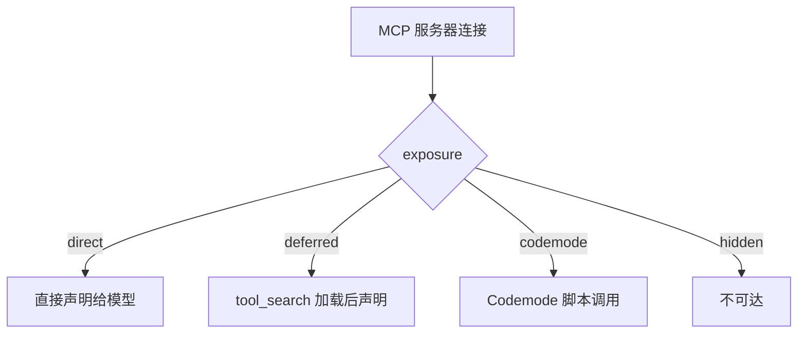
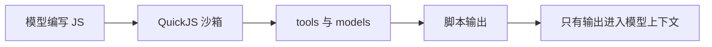

# 第 8 章 MCP 与 Codemode：接入外部工具

[← 上一章](07-customize.md) · [目录](README.md)

> **本章你将学会**：添加、检查和移除 MCP 服务器；理解四种工具暴露方式；用 Codemode 脚本并行调用工具并过滤结果；知道 MCP 与 Codemode 的权限和限制。
>
> **对应官方文档**：[Connect MCP Servers](https://pi.dev/docs/latest/mcp) · [Codemode](https://pi.dev/docs/latest/codemode) · [CLI: Tools](https://pi.dev/docs/latest/cli#tools)

## 8.1 MCP 解决什么问题

MCP（Model Context Protocol）是一个让智能体连接外部工具服务器的协议。服务器可以暴露工具（tools）和资源（resources），Pi 把它们接入模型。Pi 支持两种传输：

- **stdio**：Pi 启动一个本地子进程，通过标准输入输出通信；
- **streamable HTTP**：Pi 连接一个远程 HTTP 端点。

旧的 SSE 传输不受支持。很多同时提供 SSE 和 streamable HTTP 的服务，会在 `/mcp` 路径提供后者。

MCP 适合这些情况：

- 已经有一个 MCP 服务器，例如文件系统、Sentry、GitHub、Figma；
- 希望把外部系统的工具接入 Pi，但不想写 TypeScript 扩展；
- 工具数量多，希望按需发现，而不是全部塞进系统提示词。

三种接入方式的取舍：

| 需求 | 选择 |
|---|---|
| 外部系统已有 MCP 服务器 | MCP，配置最少 |
| 需要自定义认证、工具逻辑、事件拦截或界面 | 扩展 |
| 需要并行调用、过滤大输出、组合多个工具 | Codemode |
| 只是给模型一段说明或流程 | 技能或提示词模板 |

MCP 和扩展不是互斥的：扩展可以注册 MCP 服务器，Codemode 可以调用 MCP 工具，MCP 工具也可以触发扩展的 `tool_call`/`tool_result` 钩子。

## 8.2 添加和检查服务器

添加一个本地 stdio 服务器：

```bash
pi mcp add filesystem -- npx -y @modelcontextprotocol/server-filesystem .
```

添加一个远程服务器：

```bash
pi mcp add docs --url https://example.com/mcp --bearer-token-env-var DOCS_TOKEN
```

这些命令默认写入用户级 `~/.pi/agent/mcp.json`。加 `--local` 或 `-l` 写入项目级 `.pi/mcp.json`。项目级配置只在项目被信任后读取。

检查连接：

```bash
pi mcp list
```

该命令会连接每个启用的服务器，打印状态、工具和错误；有配置无效或启用的服务器连不上时，退出码为 1。在交互会话中运行 `/mcp` 可以查看状态、重连、登录、启用/禁用和修改暴露方式。

添加或修改服务器后，在会话中运行 `/reload`，或重启 Pi。MCP 服务器在会话启动时后台连接；`direct` 暴露的工具会让首个提示词最多等待 10 秒，其他服务器在需要时等待。

## 8.3 配置文件

`mcp.json` 的格式与其他 MCP 客户端一致：

```json
{
  "mcpServers": {
    "filesystem": {
      "command": "npx",
      "args": ["-y", "@modelcontextprotocol/server-filesystem", "."]
    },
    "docs": {
      "url": "https://example.com/mcp",
      "headers": { "Authorization": "Bearer ${DOCS_TOKEN}" },
      "description": "Search and read the product documentation"
    }
  }
}
```

stdio 服务器使用 `command`、`args`、`env`、`cwd`。`command` 是一个可执行文件，不是 shell 命令字符串。HTTP 服务器使用 `url`、`headers` 和可选的 `oauth`。

两种服务器都支持：

- `timeout`：单次请求超时，单位秒，默认 60；进度通知会重置计时。
- `enabled: false`：保留条目但不连接。
- `exposure` 和 `toolExposure`：控制工具如何到达模型。
- `description`：一句话说明服务器提供什么，用于系统提示词、工具搜索排序和 Codemode 的 `describeNamespace()`。

`env` 和 `headers` 的值支持 `${GITHUB_TOKEN}` 形式的环境变量插值，也支持以 `!command` 开头的命令，但命令必须构成整个值。

服务器名只能包含字母、数字、`_` 和 `-`。工具名格式为 `mcp__<server>__<tool>`，非字母、数字、下划线的字符会被替换为下划线。名称只差 `-` 和 `_` 的服务器视为同一个。

> 源码位置：`packages/coding-agent/src/extensions/mcp/config.ts`（配置解析与校验）、`packages/coding-agent/src/extensions/mcp/tools.ts`（工具命名与暴露控制）。

## 8.4 工具暴露方式

Pi 不会把所有 MCP 工具直接声明给模型。每个服务器有一个 `exposure` 设置：

| 暴露方式 | 行为 | 适用场景 |
|---|---|---|
| `codemode`（默认） | 可被 Codemode 脚本调用，但不直接声明给模型 | 一般服务器，尤其是需要组合或过滤调用时 |
| `deferred` | 直到 `tool_search` 为下一次模型调用加载匹配项才声明 | 工具很多、发现后再直接调用的服务器 |
| `direct` | 像内置工具一样声明给模型，也可从 Codemode 调用 | 少量、高频工具 |
| `hidden` | 已注册但不可达 | 需要暂时关闭的服务器或工具 |



`toolExposure` 可以按工具覆盖服务器级设置，键支持 `*` 通配：

```json
{
  "mcpServers": {
    "github": {
      "url": "https://api.githubcopilot.com/mcp/",
      "exposure": "deferred",
      "toolExposure": {
        "search_code": "direct",
        "get_*": "codemode",
        "delete_*": "hidden"
      }
    }
  }
}
```

当带 `codemode` 暴露的服务器连接时，Pi 会自动启用 `codemode` 工具；带 `deferred` 暴露时自动启用 `tool_search`。如果希望在没有 MCP 时也使用 Codemode，需要手动启用：

```json
{
  "defaultTools": ["+codemode"]
}
```

或单次运行：

```bash
pi --tools +codemode
```

`--tools` 默认不会移除 MCP 工具，除非某个条目以 `mcp__` 开头。要移除全部 MCP 工具，用 `--exclude-tools 'mcp__*'` 或 `--no-mcp`。

怎么选暴露方式：

- 工具少且常用，模型应直接看到：`direct`。
- 工具多，但发现后应直接调用：`deferred`，配合 `tool_search`。
- 工具结果大、需要组合或过滤：`codemode`，让脚本先处理。
- 暂时不想让任何模型或脚本访问：`hidden`。

默认的 `codemode` 暴露是有意的保守选择：它不增加每次请求的工具声明，也避免大量 MCP 工具挤占上下文。代价是模型必须写脚本才能调用，因此工具描述要清楚，必要时给服务器加 `description`。

## 8.5 Codemode 是什么

Codemode 让模型写一段 JavaScript 脚本来调用其他工具。脚本在 QuickJS 沙箱中运行，没有 Node API、文件系统、网络或定时器；它只能通过 `tools` 和 `models` 触达外部世界。

关键点：**只有脚本的输出会到达模型**。嵌套工具调用的完整结果留在脚本里，由脚本决定返回什么。



因此 Codemode 适合：

- 并行调用多个工具；
- 在把大输出交给模型前先过滤；
- 把多个 MCP 调用组合成一个结果；
- 调用分类器或图像模型处理数据。

脚本是异步函数体，支持顶层 `await` 和 `return`。可以以一行选项开头：

```js
// @options: {"max_output_tokens": 2000, "timeout_ms": 60000}
```

`max_output_tokens` 默认 10000；`timeout_ms` 是整个脚本的硬截止时间，默认不设。输出超过 16777216 字符（文本加 base64 图像）或超过 100000 次 `text()`、`image()`、`console` 调用时，脚本失败。

## 8.6 脚本 API

| 全局 | 用途 |
|---|---|
| `tools.<name>(args)` | 调用一个工具；名字中不合法的字符变成 `_` |
| `text(value)` | 向输出添加一个文本项 |
| `image(value)` | 添加一张图片：base64 `data:` URL、`{ image_url }` 或图像块 |
| `console.log(...)` | 添加到 `<console_output>` 块 |
| `return value` | 顶层返回，效果类似 `text()` |
| `exit()` | 成功结束脚本 |
| `store(key, value)` / `load(key)` | 跨调用保存小型 JSON 状态 |
| `ALL_TOOLS` | 所有可调用工具的 `{ name, description }` |
| `searchTools(query, opts)` | 按 BM25 排序查找工具，默认返回 8 个 |
| `describeTool(name)` | 返回工具描述和 TypeScript 声明 |
| `describeNamespace(name)` | 返回 MCP 服务器的描述、指令和工具列表 |
| `models` | 列出并调用分类器、图像模型 |

工具调用是真实的：脚本失败前已经执行的调用不会回滚；脚本结束时仍在运行的调用会被取消。

一个并行读取并汇总的脚本：

```js
const [readme, status] = await Promise.allSettled([
  tools.read({ path: "README.md" }),
  tools.bash({ command: "git status --short" }),
]);

if (readme.status === "fulfilled") text(readme.value);
else text(`read failed: ${readme.reason}`);

if (status.status === "fulfilled") {
  text(`exit=${status.value.exit_code}`);
  text(status.value.output);
} else {
  text(`git failed: ${status.reason}`);
}
```

`bash` 的脚本返回值是结构化的：`{ output, truncated, full_output_path?, exit_code, wall_time_seconds }`。`output` 最多 1 MiB，超过时保留首尾各 512 KiB，完整输出在临时文件中。非零退出码不会让脚本抛错；`Promise.allSettled` 让你保留成功调用的结果。

过滤测试输出，避免把整份日志塞进上下文：

```js
const result = await tools.bash({ command: "npm test" });
const lines = result.output.split("\n").filter((line) => /FAIL|Error|failed/.test(line));
text(lines.join("\n") || "no failures found");
text(`exit=${result.exit_code}, truncated=${result.truncated}`);
```

调用 MCP 工具前，先看服务器提供什么：

```js
const namespace = await describeNamespace("mcp__filesystem");
if (namespace) {
  text(namespace.tools.map((tool) => tool.name).join("\n"));
}
```

实际调用形如 `tools.mcp__filesystem__read_file({ path: "package.json" })`，工具名以服务器声明为准。MCP 工具返回完整的 `CallToolResult`，包括 `content`、`structuredContent` 和 `isError`。

Codemode 不适合这些情况：

- 只需要一次简单工具调用：直接调用更省一次脚本生成。
- 需要访问文件系统、网络或 Node API：沙箱不提供，必须通过工具。
- 需要长时间后台任务：脚本有硬超时，且脚本结束时未完成的调用会被取消。
- 需要交互式确认：脚本里没有 UI，权限门只能在工具调用层拦截。

它最适合“把多次调用压缩成一次模型可见结果”的工作，例如读取十个文件只返回摘要、并行查询多个 MCP 工具、把测试日志过滤成失败行。

## 8.7 输出预算与工具描述

Codemode 的工具描述本身也有预算。已被声明给模型的工具会带上“如何从脚本调用”的说明；未声明的工具（包括默认 `codemode` 暴露的 MCP 工具）不会列在描述里，脚本用 `searchTools()`、`describeTool()` 或 `ALL_TOOLS` 查找。

`codemode.inlineBudget` 默认 3000 个估算 token（字符数除以 4），放不下的工具不列出。`codemode.mode` 有两个值：

- `on`（默认）：已声明的工具保持声明，描述中追加脚本调用说明；`codemode` 只列未声明的工具。
- `only`：所有工具从模型前隐藏，改由 `codemode` 描述列出，模型只能通过脚本调用。

`store()` 适合保存 ID、游标或摘要。单个值最多 262144 字符 JSON，所有值合计最多 1048576 字符。写入只在脚本成功时保留，并作为 `codemode-store` 自定义条目写入会话分支。

## 8.8 资源与 OAuth

当服务器提供 MCP 资源时，Pi 会增加三个工具：

- `list_mcp_resources`：列出资源，可指定服务器或分页；
- `list_mcp_resource_templates`：列出 URI 模板；
- `read_mcp_resource`：按服务器和 URI 读取资源。文本和图片直接到达模型，其他二进制保存到临时文件并返回路径。

远程 OAuth 服务器不需要在 `mcp.json` 中写凭据。服务器拒绝未认证连接时，`/mcp` 会显示需要登录；运行 `/mcp login <server>` 或 `pi mcp login <server>`，Pi 会打开授权页并等待。令牌保存在 `~/.pi/agent/mcp-auth.json`，过期或服务器拒绝时自动刷新。无头环境中可以把重定向 URL 粘贴回登录界面。

## 8.9 权限与限制

所有 MCP 调用都经过 Pi 的工具管道，因此扩展的 `tool_call`、`tool_result` 处理器（包括权限门）同样适用于 MCP 工具。Codemode 中的嵌套调用携带 `parentToolCallId`，便于审计。

需要记住的限制：

- MCP 的文本工具结果超过 20 KB 时，模型看到的是去掉中间部分并带有截断标记的文本，完整文本在临时文件中；Codemode 脚本拿到完整结果。
- 工具调用不会因为 HTTP 瞬时错误自动重试，因为服务器可能已经执行过；列资源和读资源会重试一次。
- 停止 stdio 服务器时，Pi 关闭 stdin，发送 SIGTERM，再发送 SIGKILL 到进程组。
- 项目级 `mcp.json` 只在信任项目后读取；MCP 调用本身仍然以你的用户权限运行。

运维建议：

- 个人服务器和带凭据的服务器放在用户级 `mcp.json`；项目文件只放项目必需的服务器。
- 把服务器当成代码审查：`command` 会启动本机进程，`url` 可能把数据发给第三方。
- 服务器日志在 `~/.pi/agent/mcp.log`，超过 5 MB 轮转为 `mcp.log.1`。
- 认证失败时先运行 `pi mcp list`，再用 `/mcp` 查看完整错误和 stdio 服务器的 stderr 尾部。
- 不再使用的服务器设为 `enabled: false`，需要时再打开。`pi mcp remove` 会删除配置条目，但会保留已存储的 OAuth 凭据；需要彻底退出登录时用 `pi mcp logout`。

> 源码位置：`packages/coding-agent/src/extensions/mcp/`（MCP 连接、工具注册、OAuth、资源）、`packages/coding-agent/src/extensions/codemode/`（脚本执行、QuickJS worker、输出渲染）。

## 8.10 小结

- Pi 支持 stdio 和 streamable HTTP 的 MCP 服务器，不支持旧 SSE。
- 用 `pi mcp add`、`/mcp`、`pi mcp list` 管理服务器；项目配置受信任控制。
- 工具名格式为 `mcp__<server>__<tool>`；暴露方式决定直接声明、延迟发现还是仅脚本可达。
- Codemode 用 JavaScript 组合工具调用，只有脚本输出进入模型。
- `codemode` 在 MCP 需要时自动启用，也可以手动加入 `defaultTools`。
- MCP 调用经过工具管道，但仍以 Pi 进程权限运行。

## 练习

1. 添加一个 stdio MCP 服务器，用 `pi mcp list` 确认连接和工具数量。验收：状态为已连接，能看到工具列表。
2. 把服务器的 `exposure` 改为 `direct`，重启后确认工具直接出现在模型的工具声明中。验收：模型可以不写脚本直接调用该工具。
3. 启用 Codemode，写一个脚本并行读取两个文件并只输出差异行。验收：脚本成功，模型只看到差异，而不是两个文件的全文。
4. 用 `store()` 保存一个计数器，连续调用两次 Codemode，第二次读出并递增。验收：第二次能读到第一次写入的值，会话中出现 `codemode-store` 条目。
5. 为项目添加 `.pi/mcp.json`，分别在不信任和信任项目的情况下启动。验收：不信任时服务器不加载；信任后加载。
6. 写一个 Codemode 脚本调用 MCP 工具，先用 `describeNamespace()` 列出工具名。验收：脚本使用的工具名与服务器声明一致，结果被正确汇总。

## 延伸阅读

- [官方文档：Connect MCP Servers](https://pi.dev/docs/latest/mcp)
- [官方文档：Codemode](https://pi.dev/docs/latest/codemode)
- [官方文档：CLI Tools](https://pi.dev/docs/latest/cli#tools)
- 源码：`packages/coding-agent/src/extensions/mcp/`、`packages/coding-agent/src/extensions/codemode/`、`packages/coding-agent/src/extensions/tool-search/`

---

[目录](README.md) · [下一章 →](09-extensions.md)
