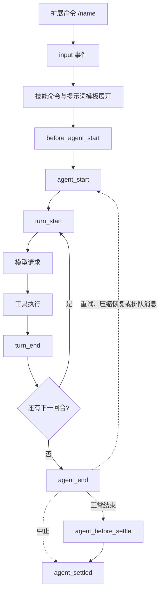
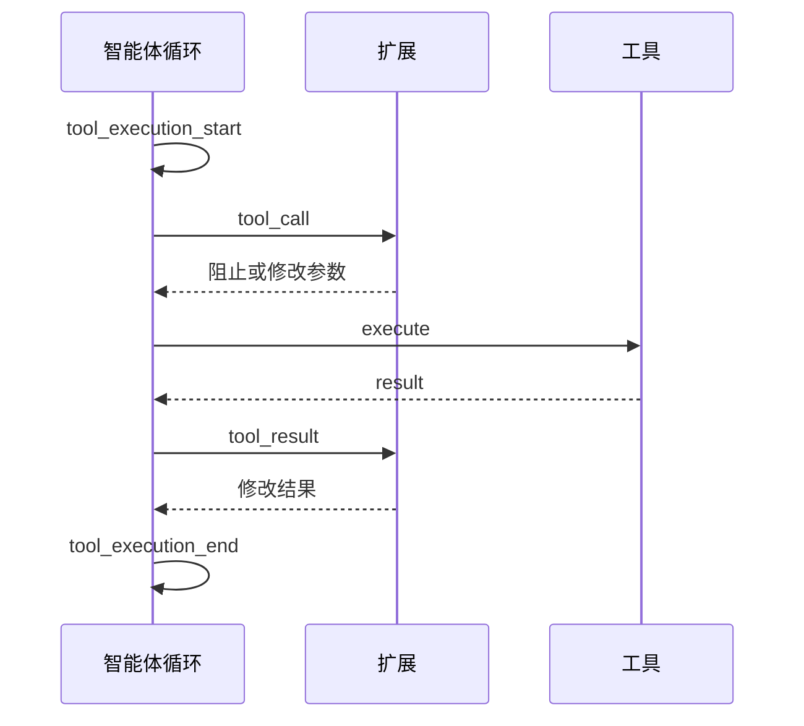

# 第 9 章 开发扩展

[← 上一章](08-mcp-codemode.md) · [目录](README.md)

> **本章你将学会**：写一个可加载的 Pi 扩展；理解扩展的生命周期事件；注册自定义工具、命令、快捷键和 CLI 参数；用 `ctx.ui` 与用户交互；持久化扩展状态；调试并安全地分发扩展。
>
> **对应官方文档**：[Extensions](https://pi.dev/docs/latest/extensions) · [Build Terminal UI Components](https://pi.dev/docs/latest/tui)

## 9.1 扩展是什么

扩展（extension）是加载进 Pi 进程的 TypeScript 模块。它的默认导出是一个工厂函数，接收 `ExtensionAPI`：

```typescript
import type { ExtensionAPI } from "@earendil-works/pi-coding-agent";

export default function (pi: ExtensionAPI) {
  // 注册事件、工具、命令、快捷键……
}
```

扩展可以：

- 监听生命周期事件，阻止或修改工具调用、注入上下文、定制压缩；
- 注册模型可调用的工具；
- 注册斜杠命令、快捷键和 CLI 参数；
- 通过 `ctx.ui` 与用户交互，或渲染自定义终端组件；
- 注册提供商、虚拟模型和 MCP 服务器；
- 把状态写入会话，跨重启恢复。

代价是：扩展在 Pi 进程内运行，拥有与 Pi 相同的操作系统权限，可以读取提示词、工具调用、文件、凭据和会话历史。只加载你信任的扩展。

什么时候不该写扩展：

- 只是想让 Pi 遵守一段规则：用 `AGENTS.md`。
- 只是复用一段提示词：用提示词模板。
- 只是提供流程和参考资料：用技能。
- 只是接入已有 MCP 服务器：用 MCP。
- 只是改变颜色：用主题。

当需求包含“必须强制执行”“必须调用外部程序”“必须响应工具调用”“必须增加一个模型可调用的函数”时，才进入扩展的领域。

## 9.2 第一个扩展

扩展的自动发现位置：

| 路径 | 作用域 |
|---|---|
| `~/.pi/agent/extensions/*.ts` 或 `*.js` | 用户级 |
| `~/.pi/agent/extensions/*/index.ts` 或 `index.js` | 用户级子目录 |
| `~/.pi/agent/extensions/*/package.json`（含 `pi.extensions`） | 带清单的扩展包 |
| `.pi/extensions/...` | 项目级，同样布局 |

发现只向下深入一层。更大的项目在 `package.json` 的 `pi.extensions` 中声明入口。

写一个最小扩展 `~/.pi/agent/extensions/hello.ts`：

```typescript
import { type ExtensionAPI } from "@earendil-works/pi-coding-agent";
import { readFile } from "node:fs/promises";
import { resolve } from "node:path";
import { Type } from "typebox";

export default function (pi: ExtensionAPI) {
  pi.on("session_start", async (_event, ctx) => {
    ctx.ui.notify("hello extension loaded", "info");
  });

  pi.registerCommand("hello", {
    description: "Say hello",
    handler: async (args, ctx) => {
      ctx.ui.notify(`Hello ${args || "world"}!`, "info");
    },
  });

  pi.registerTool({
    name: "count_lines",
    label: "Count lines",
    description: "Count the lines in a text file",
    parameters: Type.Object({
      path: Type.String({ description: "File path relative to the working directory" }),
    }),
    async execute(_toolCallId, params, _signal, _onUpdate, ctx) {
      const content = await readFile(resolve(ctx.cwd, params.path), "utf8");
      const lines = content.split("\n").length;
      return {
        content: [{ type: "text", text: `${params.path}: ${lines} lines` }],
        details: {},
      };
    },
  });
}
```

用 `-e` 临时加载，测试时不必写进设置：

```bash
pi -e ./hello.ts
```

扩展通过 jiti 加载，TypeScript 无需预先编译。扩展可以导入 Node 内置模块、Pi 提供的包（`pi-coding-agent`、`pi-agent-core`、`pi-ai`、`pi-tui`、`typebox`），也可以在同一目录放 `package.json` 并通过 `npm install` 使用其他 npm 包。

## 9.3 生命周期事件

一次用户提示词的处理顺序：



关键事件：

| 事件 | 用途 | 能否干预 |
|---|---|---|
| `input` | 在提示词进入智能体前拦截或改写 | 返回处理结果可阻止后续流程 |
| `before_agent_start` | 注入消息、修改系统提示词 | 可返回 `message` 或 `systemPrompt` |
| `agent_start` / `agent_end` | 观察一次低层运行 | 通知为主 |
| `agent_before_settle` | 运行自动结束前的最后干预点 | 可追加条目并请求一次继续 |
| `agent_settled` | Pi 不会再自动继续 | 通知 |
| `turn_start` / `turn_end` | 每个回合 | `turn_end` 可追加条目或请求继续 |
| `tool_call` | 工具执行前 | 可阻止或修改输入 |
| `tool_result` | 工具执行后 | 可修改结果 |
| `session_start` / `session_shutdown` | 会话生命周期 | 初始化与清理 |
| `session_before_compact` / `session_compact` | 压缩前后 | 可取消或提供自定义摘要 |
| `session_before_tree` / `session_tree` | 会话树导航 | 可取消或定制摘要 |
| `project_trust` | 项目信任决定前 | 可返回 `trusted: "yes" \| "no" \| "undecided"` |

`agent_end` 不是最终空闲信号：自动重试、压缩后重试、转向或后续消息都可能继续工作。需要“Pi 真的停了”时用 `agent_settled`。中止的运行会跳过 `agent_before_settle`，从 `agent_end` 直接进入 `agent_settled`。

工具调用的钩子顺序：

```text
tool_execution_start
  → tool_call（可阻止或改参数）
  → tool_execution_update（执行中）
  → tool_result（可改结果）
  → tool_execution_end
```

未知工具或参数无效的调用会跳过 `tool_call`；被阻止的调用跳过执行和 `tool_result`，但仍会收到带错误结果的 `tool_execution_end`。要观察每一次最终调用，用 `tool_execution_end`。



事件处理器按扩展加载顺序、再按注册顺序执行。不同事件的组合方式不同：

| 模式 | 行为 | 例子 |
|---|---|---|
| 通知 | 忽略返回值 | `agent_start`、`agent_settled` |
| 原地修改 | 后续处理器看到修改后的值 | `tool_call.input`、`before_provider_headers.headers` |
| 链式转换 | 后续处理器接收前一个处理器的返回值 | `input`、`context`、`tool_result`、`message_end` |
| 门控 | 处理过的输入、被阻止的工具、被取消的操作停止默认流程 | `input`、`tool_call`、`session_before_switch` |
| 最后覆盖 | 最后一个返回动作的处理器生效 | `cache_warming_decision` |

转换型处理器应保留自己不改的字段；安全门在无法判断时应失败关闭（fail closed）。通知型处理器不要做慢工作，否则会阻塞流式输出。

## 9.4 自定义工具

`pi.registerTool()` 注册模型可调用的工具。最小定义（在扩展工厂内，使用前面导入的 `Type`）：

```typescript
import { StringEnum } from "@earendil-works/pi-ai";

pi.registerTool({
  name: "my_tool",
  label: "My Tool",
  description: "What this tool does (shown to the model)",
  parameters: Type.Object({
    action: StringEnum(["list", "add"] as const),
    text: Type.Optional(Type.String()),
  }),
  async execute(toolCallId, params, signal, onUpdate, ctx) {
    return {
      content: [{ type: "text", text: "Done" }],
      details: {},
    };
  },
});
```

要点：

- `parameters` 用 TypeBox 定义；字符串枚举优先用 `@earendil-works/pi-ai` 的 `StringEnum`，所有提供商都接受。
- `execute` 的返回值必须有模型可见的 `content` 和任意 `details`；`details` 类型在同一工具的所有结果中保持一致。
- 用 `onUpdate?.({ content, details })` 流式报告进度。
- 失败时抛出错误，或返回 `isError: true`。抛错会丢失 `details`；需要保留数据时返回错误结果。
- 工具默认并行执行。共享可变状态或必须顺序执行的工具设置 `executionMode: "sequential"`。
- 修改文件的工具应使用 `withFileMutationQueue()`，与内置 `edit`/`write` 共享逐文件队列，避免同一回合中的并发修改互相覆盖。
- `promptSnippet` 给工具加一行系统提示词条目；`promptGuidelines` 追加规则，规则中必须写出工具名，例如“Use my_tool when…”。
- `defaultActive: false` 让工具注册但默认不启用，可通过 `defaultTools` 或 `pi.setActiveTools()` 打开。
- 同名注册会覆盖内置工具。覆盖时渲染器按槽位继承：不写 `renderCall` 就用内置的，不写 `renderResult` 也用内置的，便于只包一层访问控制。

需要结构化输出的工具可以声明 `outputSchema` 并返回 `structuredContent`。模型仍收到 `content`，Codemode 脚本收到 `structuredContent`。批处理中所有最终结果都返回 `terminate: true` 时，可以跳过后续模型调用。

工具结果还会被界面和会话依赖，因此要注意：

- `details` 在同一工具的所有结果中保持同一类型；界面渲染、状态恢复和脚本调用都会读取它。
- 只改执行、不改渲染时，覆盖内置工具会自动继承内置的 `renderCall`/`renderResult`。
- 需要自定义显示时，可以实现 `renderCall(args, theme, context)` 和 `renderResult(result, options, theme, context)`；这两个函数只影响 TUI，不影响模型看到的内容。
- 工具参数 schema 要严格；需要兼容旧会话的旧参数形状时，用 `prepareArguments()` 在验证前转换，而不是在 schema 里保留废弃字段。

> 源码位置：`packages/coding-agent/src/core/extensions/types.ts`（工具定义、事件与上下文类型）、`packages/agent/src/agent-loop.ts`（工具执行、并行调度与结果事件）。

## 9.5 命令、快捷键、参数与界面

注册命令：

```typescript
pi.registerCommand("stats", {
  description: "Show session statistics",
  getArgumentCompletions: (prefix) => {
    const items = ["default", "summary"].map((value) => ({ value, label: value }));
    const filtered = items.filter((item) => item.value.startsWith(prefix));
    return filtered.length > 0 ? filtered : null;
  },
  handler: async (args, ctx) => {
    const count = ctx.sessionManager.getEntries().length;
    ctx.ui.notify(`${count} entries`, "info");
  },
});
```

同名命令由多个扩展注册时，Pi 保留全部并按加载顺序加后缀，例如 `/review:1`、`/review:2`。

注册快捷键和 CLI 参数：

```typescript
pi.registerShortcut("ctrl+shift+p", {
  description: "Show a status message",
  handler: async (ctx) => ctx.ui.notify("Shortcut fired", "info"),
});

pi.registerFlag("plan", {
  description: "Start in plan mode",
  type: "boolean",
  default: false,
});

pi.on("session_start", () => {
  if (pi.getFlag("plan")) {
    // 参数值在扩展加载后才可用
  }
});
```

`ctx.ui` 提供：

- `notify(message, level)`：显示通知；
- `confirm(title, message)`、`select(...)`、`input(...)`、`editor(...)`：阻塞式对话框；
- `setStatus(id, text)`：设置页脚状态；
- `setWidget(id, lines)`：在编辑器上方显示小组件；
- `setTitle(...)`、`setEditorText(...)`；
- `custom(...)`：渲染完整 TUI 组件，仅交互模式可用。

根据运行模式做保护：

```typescript
if (ctx.mode === "tui") {
  // 终端专属 UI
}

if (ctx.hasUI) {
  // TUI 和 RPC 模式下都可以显示对话框或通知
}
```

`ctx.mode` 是 `"tui"`、`"rpc"`、`"json"` 或 `"print"`。`ctx.hasUI` 在 TUI 和 RPC 下为 `true`，在打印和 JSON 模式下为 `false`。终端专属能力不能在打印模式中静默调用。

## 9.6 状态、消息与会话

扩展有两类持久化：

- `pi.appendEntry(customType, data)`：写入自定义条目，**不**进入模型上下文；交互模式可用 `pi.registerEntryRenderer()` 自定义渲染。
- `pi.sendMessage({ customType, content, display }, options)`：注入自定义消息，**会**进入模型上下文。

恢复状态：

```typescript
pi.on("session_start", async (_event, ctx) => {
  for (const entry of ctx.sessionManager.getEntries()) {
    if (entry.type === "custom" && entry.customType === "my-state") {
      // 从 entry.data 恢复
    }
  }
});
```

`sendMessage` 的投递方式：

- `"steer"`（默认）：在当前助手回合及其工具调用完成后插入；
- `"followUp"`：等当前任务完全空闲后处理；
- `"nextTurn"`：排到下一次用户提示词。

`triggerTurn: true` 让空闲会话立即开始一轮。`pi.sendUserMessage()` 发送的是用户消息，行为像用户亲手输入；流式期间必须指定 `deliverAs`。

其他常用方法：

- `pi.setSessionName(name)` / `pi.getSessionName()`；
- `pi.setLabel(entryId, label)`：为会话树节点加书签；
- `pi.getActiveTools()` / `pi.getAllTools()` / `pi.setActiveTools(names)`；
- `ctx.getContextUsage()` 查看上下文用量；
- `ctx.compact({ customInstructions, onComplete, onError })` 触发压缩；
- `ctx.shutdown()` 请求优雅退出；
- `pi.exec(command, args, options)` 不经过 shell 执行命令。

## 9.7 调试与资源生命周期

- 用 `pi -e ./path.ts` 快速加载单个扩展；`/reload` 重新加载自动发现的扩展。
- 扩展工厂抛错或事件处理器抛错会显示错误；RPC 模式还会发送 `extension_error`。
- 异步工厂会在 `session_start` 之前完成。适合一次性拉取远程配置或动态发现模型。
- 不要在工厂里启动后台进程、socket、文件监视器或定时器。工厂可能在根本不启动会话的调用中执行。把资源启动推迟到 `session_start` 或真正需要它的命令/工具里，并在 `session_shutdown` 中幂等清理。
- 事件处理器要避免在流式事件上做慢工作，否则会拖慢每个 token。

一个安全门示例，阻止危险的 `rm -rf`：

```typescript
import { type ExtensionAPI, isToolCallEventType } from "@earendil-works/pi-coding-agent";

export default function (pi: ExtensionAPI) {
  pi.on("tool_call", async (event, ctx) => {
    if (!isToolCallEventType("bash", event)) return;
    if (!/\brm\s+-rf\b/.test(event.input.command)) return;

    if (!ctx.hasUI) {
      return { block: true, reason: "Destructive command blocked: no UI to confirm" };
    }
    const ok = await ctx.ui.confirm("Dangerous command", event.input.command);
    if (!ok) return { block: true, reason: "Blocked by user" };
  });
}
```

这个例子体现了三条原则：只匹配自己负责的工具；没有确认界面时失败关闭；阻止时给出原因。真实的安全门还应覆盖 `sudo`、写入敏感路径、网络上传等模式，并注意 shell 命令可以有多种等价写法。

扩展的加载位置、项目信任和分发：

- 用户级扩展对所有项目生效；
- 项目级 `.pi/extensions/` 只在信任后加载；
- 分发用 Pi 包，把扩展、技能、模板和主题一起发布；
- 不要把 Pi 提供的包写进 `dependencies`，用 `peerDependencies`。

> 源码位置：`packages/coding-agent/src/core/extensions/loader.ts`（发现与加载）、`packages/coding-agent/src/core/extensions/runner.ts`（事件分发与扩展运行时）、`packages/coding-agent/src/core/extensions/types.ts`（事件、上下文与 API 类型）、`packages/coding-agent/examples/extensions/`（可运行示例）。

## 9.8 测试与分发

开发期：

1. 在临时目录创建扩展，用 `pi -e ./ext.ts` 加载，避免污染全局配置。
2. 分别测试交互模式和打印模式：涉及 `ctx.ui` 的代码在打印模式下应被 `ctx.hasUI` 保护。
3. 测试工具的错误路径：无效参数、取消信号、命令失败、无权限。
4. 修改后运行 `/reload`，确认状态能从会话条目恢复，而不是依赖内存变量。
5. 如果扩展依赖 npm 包，在扩展目录放 `package.json` 并安装依赖；不要依赖 Pi 进程的偶然模块解析。

分发：

- 把扩展放进 Pi 包，在 `package.json` 的 `pi.extensions` 中声明入口。
- 运行时依赖放 `dependencies`；Pi 提供的包放 `peerDependencies`，范围写 `*`。
- 用 `pi install` 或 `-e` 验证安装后的行为，而不只是源码目录。
- 在 `CHANGELOG.md` 中记录用户可见的变化；加载扩展的包会在更新后显示变更日志。
- 扩展会读取敏感数据，发布前审查日志、错误信息和默认配置，避免打印提示词、凭据或完整文件内容。

发布后，用户仍需要信任项目或手动安装。扩展没有“安全沙箱”可依赖，文档中应明确它访问哪些文件、网络和命令。

## 9.9 小结

- 扩展是 `ExtensionAPI` 工厂，可注册事件、工具、命令、快捷键、参数和 UI。
- 生命周期从 `input` 到 `agent_settled`；`agent_end` 之后仍可能有自动工作。
- 工具定义包含 TypeBox 参数、`execute`、`content`/`details` 和可选的渲染器；修改文件的工具要接入 `withFileMutationQueue()`，共享状态的工具考虑顺序执行。
- 用 `appendEntry` 保存不进入上下文的状态，用 `sendMessage` 注入会进入上下文的消息；后台资源放在 `session_start` / `session_shutdown` 中管理。
- 扩展拥有完整权限，只加载信任的代码，并在无法确认时失败关闭。
- 分发前在交互和打印模式下分别测试，并验证安装后的包行为。

## 练习

1. 写一个扩展，在 `session_start` 时显示当前会话文件路径。验收：启动后出现通知，路径与 `/session` 一致。
2. 注册一个工具，读取文件并返回行数；在打印模式中使用它。验收：工具出现在工具列表中，结果正确，未调用任何 UI。
3. 写一个 `tool_call` 处理器阻止包含 `sudo` 的命令，并在无 UI 时同样阻止。验收：交互模式下可以取消，打印模式下直接阻止。
4. 用 `pi.appendEntry()` 保存一个计数器，在 `session_start` 恢复，并提供 `/count` 命令递增。验收：重启 Pi 后计数保留。
5. 注册一个快捷键和一个 CLI 参数，验证两者都能生效。验收：快捷键触发通知，`--plan` 能被 `pi.getFlag("plan")` 读到。
6. 故意在扩展工厂中抛错，观察报错位置；再把它移到异步初始化中。验收：能说明两种失败发生在启动的哪个阶段。

## 延伸阅读

- [官方文档：Extensions](https://pi.dev/docs/latest/extensions)
- [官方文档：Build Terminal UI Components](https://pi.dev/docs/latest/tui)
- [官方文档：Keybindings](https://pi.dev/docs/latest/keybindings)
- 源码：`packages/coding-agent/src/core/extensions/loader.ts`、`runner.ts`、`types.ts`
- 示例：`packages/coding-agent/examples/extensions/`（`confirm-destructive.ts`、`todo.ts`、`plan-mode/`、`subagent/`）

---

[目录](README.md) · [下一章 →](10-automation.md)
