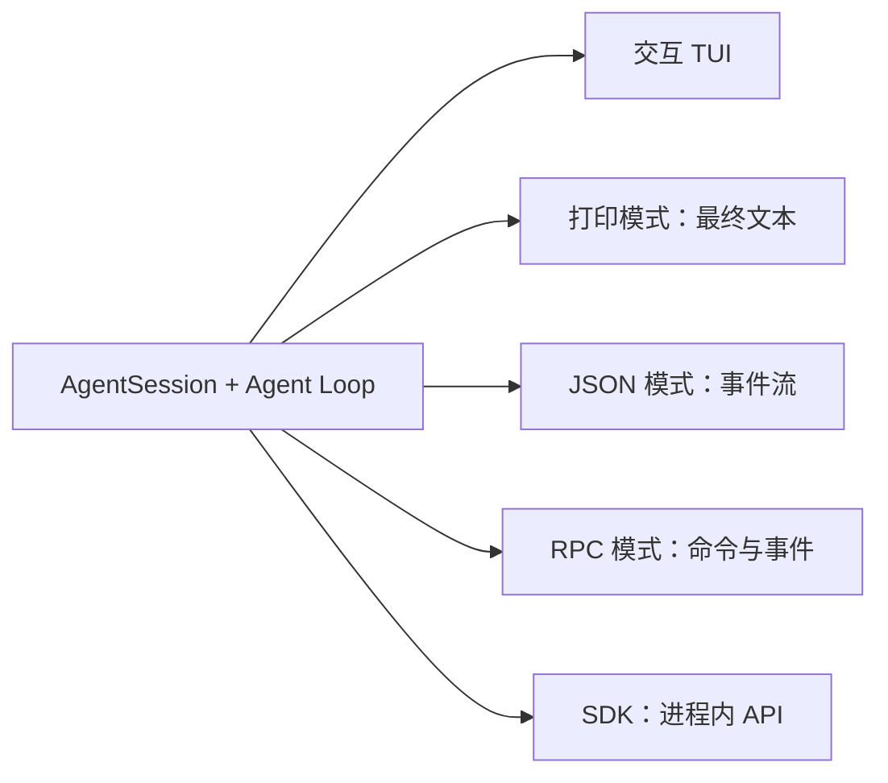

# 第 10 章 自动化与嵌入

[← 上一章](09-extensions.md) · [目录](README.md)

> **本章你将学会**：在脚本和 CI 中使用打印模式；消费 JSON 事件流；用 RPC 控制一个长期运行的 Pi 进程；用 TypeScript SDK 在应用内创建会话；为自动化选择正确的接口和隔离方式。
>
> **对应官方文档**：[Integrate with the CLI](https://pi.dev/docs/latest/cli-integration) · [Command Line](https://pi.dev/docs/latest/cli) · [JSON Event Stream](https://pi.dev/docs/latest/json) · [RPC Mode](https://pi.dev/docs/latest/rpc) · [SDK](https://pi.dev/docs/latest/sdk)

## 10.1 五种接口

| 接口 | 进程边界 | 生命周期 | 适用场景 |
|---|---|---|---|
| 交互模式 | 同一进程 | 直到用户退出 | 人直接使用 |
| 打印模式 | 同一进程 | 一次运行 | 脚本只要最终文本 |
| JSON 模式 | 同一进程 | 一次运行 | 需要结构化的过程事件 |
| RPC 模式 | 子进程 | 长期运行 | 其他语言、IDE、自定义客户端 |
| SDK | 同一进程 | 由宿主控制 | Node.js 或 Bun 应用内嵌 |

五种接口共用同一套智能体、会话、资源和工具。区别只在于输入如何进入、输出如何暴露、进程是否继续接受命令。



选择原则：

- 只要最终答案，用打印模式。
- 要实时展示过程或做日志分析，用 JSON 模式。
- 要持续发多条命令、切换模型、管理会话，用 RPC。
- TypeScript 应用需要直接访问会话对象和事件，用 SDK。

一个常见的误判是“用 JSON 模式解析最终答案”。JSON 模式输出的是过程事件，不是单一结果；最终答案在 `message_end` 里，而且可能有多条助手消息。只要最终文本时，打印模式更直接。

反过来，如果需要知道“用了哪些工具、失败了没有、是否压缩过”，打印模式不够，应该用 JSON 模式或 RPC 的事件流。

## 10.2 打印模式

```bash
pi --print "总结这个仓库的测试方式"
```

`-p` 是 `--print` 的缩写。Pi 运行完提示词，把最后一条助手文本写到标准输出，然后退出。中间事件不暴露。输入可以来自管道：

```bash
git diff | pi --print "审查这个改动，只列出可能导致回归的问题"
```

`@file` 参数仍然可用：

```bash
pi -p @README.md "把安装步骤改写成三个要点"
```

退出状态：

- 正常完成：0。
- 助手响应以 `error` 或 `aborted` 结束：非零。
- 因输出 token 上限截断（`length`）：仍打印部分文本到 stdout，向 stderr 写警告，退出码非零。

错误写 stderr，不污染 stdout 的结果文本。当 stdin 或 stdout 被重定向且没有显式选择 JSON 或 RPC 模式时，Pi 自动使用打印模式。

打印模式没有交互界面，因此无法弹出项目信任询问。自动化中要么使用已保存的信任决定，要么显式传 `--approve`/`--no-approve`，要么设置 `defaultProjectTrust`。

一个 CI 片段：

```bash
set -euo pipefail

: "${ANTHROPIC_API_KEY:?missing ANTHROPIC_API_KEY}"
pi --no-session --approve -p \
  "运行测试，只输出失败测试名和最早的一条错误。不要修改文件。" \
  > test-summary.txt

cat test-summary.txt
```

`set -e` 会在 Pi 返回非零时中止任务。`--no-session` 避免读取或写入开发机上的旧会话；`--approve` 只在确认仓库可信时使用。要求“不要修改文件”只是提示，不是强制约束；需要只读时用 `--tools read,grep,find,ls` 限制工具集。

## 10.3 JSON 模式

```bash
pi --mode json "检查这个仓库并列出风险点" > events.jsonl
```

JSON 模式先写一条会话头，再写会话事件，任务完成后退出。每条记录是一个 JSON 对象，以 LF 分隔。stdout 只用于协议记录，诊断信息写 stderr。

一次基本运行的事件序列（示意，省略了第一行会话头，部分字段未展开）：

```jsonl
{"type":"agent_start"}
{"type":"turn_start"}
{"type":"message_start","message":{"role":"user","content":"检查这个仓库","timestamp":1733234401000}}
{"type":"message_end","message":{"role":"user","content":"检查这个仓库","timestamp":1733234401000}}
{"type":"message_start","message":{"role":"assistant","content":[],"stopReason":"pending"}}
{"type":"message_update","assistantMessageEvent":{"type":"text_delta","contentIndex":0,"delta":"我先"}}
{"type":"message_end","message":{"role":"assistant","stopReason":"stop"}}
{"type":"turn_end","message":{"role":"assistant"},"toolResults":[]}
{"type":"agent_end","messages":[],"willRetry":false}
{"type":"agent_settled","aborted":false}
```

关键点：

- `message_update` 只包含增量（delta），不包含累计消息。用 `contentIndex` 定位内容块，缓冲 `text_delta`；收到 `text_end` 或 `message_end` 后以完整内容为准。
- `tool_execution_start`、`tool_execution_update`、`tool_execution_end` 用 `toolCallId` 关联。`tool_execution_update` 携带工具的最新部分结果。
- `agent_end` 表示一次低层运行结束，之后仍可能有自动重试、压缩重试或排队消息。
- `agent_settled` 表示 Pi 不会再自动继续。脚本要判断“完成”，应等这个事件。
- `compaction_start` 的 `reason` 是 `manual`、`threshold` 或 `overflow`；`compaction_end` 携带摘要结果或错误。

只提取最终消息：

```bash
pi --mode json "列出所有 TypeScript 文件" 2>/dev/null \
  | jq -c 'select(.type == "message_end")'
```

统计工具调用：

```bash
pi --mode json "运行测试并总结失败项" 2>/dev/null \
  | jq -r 'select(.type == "tool_execution_start") | .toolName' \
  | sort | uniq -c
```

JSON 模式的退出码不反映模型层面的失败。助手回复失败或中止仍会出现在事件流中，但进程本身可能以 0 退出。需要判断成败时，检查 `message_end` 的 `stopReason`、`agent_settled.aborted` 或相关错误事件。

常用事件及其判断用途：

| 事件 | 关键字段 | 用途 |
|---|---|---|
| `message_end` | `message.role`、`message.stopReason` | 取最终消息，判断停止原因 |
| `tool_execution_end` | `toolName`、`isError`、`durationMs` | 统计工具失败和耗时 |
| `turn_end` | `message`、`toolResults` | 一个助手回合结束 |
| `compaction_end` | `reason`、`result`、`errorMessage` | 判断压缩是否成功 |
| `auto_retry_start` / `auto_retry_end` | `attempt`、`success`、`finalError` | 观察自动重试 |
| `agent_settled` | `aborted` | 判断 Pi 是否还会自动继续 |

不要把 `agent_end` 当作完成信号，也不要假设每个 `message_end` 都是助手消息；用户消息、工具结果和自定义消息也会触发消息事件。

## 10.4 RPC 模式

RPC 模式把 Pi 作为长期运行的子进程，用 stdin 和 stdout 上的 JSONL 通信：

```bash
pi --mode rpc --no-session
```

协议有四类记录：

| 方向 | 记录 | 用途 |
|---|---|---|
| stdin | 命令 | 提示、查状态、改配置、管理会话 |
| stdout | `response` | 某条命令是否成功及返回数据 |
| stdout | 会话事件 | 运行、消息、工具、队列、压缩、重试 |
| 双向 | 扩展 UI 记录 | 对话框、通知等交互 |

命令可以带字符串 `id`，响应会重复该 ID：

```json
{"id":"req-1","type":"get_state"}
{"id":"req-1","type":"response","command":"get_state","success":true,"data":{"...":"..."}}
```

命令异步处理，客户端应按 ID 关联，而不是依赖响应顺序。会话事件通常没有命令 ID，`bash_execution_update` 例外。

`prompt` 的成功响应只表示提示被接受、排队或处理，不表示模型工作完成：

```json
{"id":"req-2","type":"prompt","message":"检查这个仓库"}
{"id":"req-2","type":"response","command":"prompt","success":true,"data":{"disposition":"started"}}
```

`disposition` 为 `"handled"` 时没有启动运行，不要等待 `agent_settled`。其他情况下继续消费事件，直到 `agent_settled`。

一个最小的 Python 客户端：

```python
import json
import subprocess

process = subprocess.Popen(
    ["pi", "--mode", "rpc", "--no-session"],
    stdin=subprocess.PIPE,
    stdout=subprocess.PIPE,
)

command = {"id": "prompt-1", "type": "prompt", "message": "Hello"}
process.stdin.write(json.dumps(command).encode("utf-8") + b"\n")
process.stdin.flush()

while line := process.stdout.readline():
    record = json.loads(line)
    if record.get("type") == "message_update":
        update = record["assistantMessageEvent"]
        if update["type"] == "text_delta":
            print(update["delta"], end="", flush=True)
    elif record.get("type") == "agent_settled":
        print()
        break

process.stdin.close()
process.wait()
```

要点：

- 按 LF 切分记录。不要用会把 `U+2028`、`U+2029` 当作换行的通用行读取器，它们是 JSON 字符串中的合法字符。
- 持续读取 stdout，否则管道缓冲写满会阻塞 Pi。
- 写入命令时遵守 stdin 背压。
- 关闭子进程 stdin 请求有序关闭；客户端仍要处理启动失败、意外退出和信号。
- stdout 只用于协议记录，不要把 stderr 当协议数据解析。

TypeScript 客户端优先用导出的 `RpcClient`。它启动子进程、关联请求、提供类型化方法，并把事件交给监听器。`promptAndWait()` 会在发送提示前安装监听器，避免快速完成时的竞态。

RPC 命令覆盖的范围很广，常见分组：

| 分组 | 命令示例 |
|---|---|
| 对话 | `prompt`、`steer`、`follow_up`、`abort`、`clear_queue` |
| 状态 | `get_state`、`get_messages`、`get_session_stats`、`get_last_assistant_text` |
| 模型 | `set_model`、`cycle_model`、`get_available_models`、`set_thinking_level` |
| 会话 | `new_session`、`switch_session`、`fork`、`clone`、`get_tree` |
| 上下文 | `compact`、`set_auto_compaction`、`get_entries` |
| 命令 | `bash`、`abort_bash`、`export_html` |

完整字段以 `rpc-commands.md` 和 `rpc-types.ts` 为准。客户端不要依赖命令响应顺序，也不要把 stderr 当作协议数据。

> 源码位置：`packages/coding-agent/src/modes/rpc/rpc-types.ts`（命令与响应类型）、`packages/coding-agent/src/modes/rpc/rpc-client.ts`（子进程客户端）。

## 10.5 TypeScript SDK

SDK 把 Pi 嵌入 Node.js 或 Bun 进程，直接提供智能体、会话、工具、模型和资源的 TypeScript 访问。

最小示例：

```typescript
import { createAgentSession } from "@earendil-works/pi-coding-agent";

const { session } = await createAgentSession();

try {
  await session.prompt("当前目录里有哪些文件？");
  console.log(session.getLastAssistantText());
} finally {
  session.dispose();
}
```

`createAgentSession()` 默认使用当前工作目录、已发现的资源、已保存的设置和已配置的凭据。`prompt()` 在运行结束时 resolve。

订阅流式输出：

```typescript
const unsubscribe = session.subscribe((event) => {
  if (event.type === "message_update" && event.assistantMessageEvent.type === "text_delta") {
    process.stdout.write(event.assistantMessageEvent.delta);
  }
});

try {
  await session.prompt("解释这个仓库的目录结构");
} finally {
  unsubscribe();
  session.dispose();
}
```

事件语义与 JSON 模式一致：`message_end` 是权威完成消息，`agent_end` 不是最终空闲信号，`agent_settled` 才表示不会自动继续。

会话存储：

```typescript
import { createAgentSession, SessionManager } from "@earendil-works/pi-coding-agent";

const { session } = await createAgentSession({
  sessionManager: SessionManager.inMemory(),
});
```

不传 `sessionManager` 时使用持久化会话。`SessionManager` 负责条目树和活动叶子；分支只改变叶子，不删除旧分支。组装模型上下文时，它选择活动分支并应用压缩。`SessionManager` 是最终模型上下文的权威来源；直接给 `session.agent.state.messages` 赋值不会替换持久化上下文。

`AgentSessionRuntime` 在 `AgentSession` 之上增加 `newSession()`、`switchSession()`、`fork()` 和 `importFromJsonl()`。每次操作会替换活动会话并重建服务；旧会话上的订阅必须重新绑定。

可替换的边界：

| 选项 | 作用 |
|---|---|
| `modelRuntime`、`model`、`thinkingLevel`、`scopedModels` | 模型访问与选择 |
| `settingsManager` | 合并后的设置或内存设置 |
| `sessionManager` | 持久化或内存会话 |
| `resourceLoader` | 扩展、技能、模板、主题、上下文文件 |
| `tools`、`noTools`、`excludeTools`、`customTools` | 活动工具集 |

`DefaultResourceLoader` 提供标准发现流程，也可传入内联扩展工厂。完全接管资源存储时，实现自定义 `ResourceLoader`。

SDK 会话不会自动加载 CLI 的内置扩展。需要 Codemode、工具搜索或 MCP 时，把 `createCodemodeExtension()`、`createToolSearchExtension()`、`createMcpExtension()` 加入 `DefaultResourceLoader` 的 `extensionFactories`，并调用 `session.bindExtensions()`。具体示例见 SDK 的 `14-codemode-mcp.ts`。

用 `session.dispose()` 释放会话：中止活动工作、失效扩展上下文、断开智能体连接、移除监听器。

## 10.6 错误处理与生命周期

不同接口的错误暴露方式不同：

| 接口 | 如何发现失败 |
|---|---|
| 打印模式 | 进程退出码；错误和警告在 stderr |
| JSON 模式 | `message_end` 的 `stopReason`、`agent_settled.aborted`、错误事件 |
| RPC | `success: false` 的响应，以及事件流中的错误状态 |
| SDK | `prompt()` 的异常、最终消息的 `stopReason`、订阅到的事件 |

SDK 中，`prompt()` resolve 不代表任务一定成功。它表示这次运行结束；提供商错误、上下文溢出或中止可能体现在最终助手消息的 `stopReason` 和 `errorMessage` 中。生产代码应同时检查返回值和最终消息。

生命周期方法：

- `session.abort()` 停止当前操作并等待会话空闲；`waitForIdle()` 只等待，不中止。
- `session.dispose()` 中止活动工作、失效扩展上下文、断开连接、移除监听器。宿主不再使用时必须调用。
- `AgentSessionRuntime` 替换活动会话后，旧订阅属于旧 `AgentSession`，必须重新绑定。
- `agent_settled` 表示不会再有自动工作；`message_end` 是单条消息的权威结果。

为外部调用设置超时，并处理子进程退出、stdin 关闭和 stdout 背压。不要让 SDK 会话或 RPC 子进程在异常路径中泄漏。

## 10.7 自动化中的安全与可靠性

- 用环境变量提供凭据，避免在 CI 日志或产物中留下 `auth.json`。
- 需要可复现时，用 `--no-session` 或独立的 `--session-dir`，避免读到开发机上的旧会话。
- 自动化没有交互界面，项目信任要么预先保存，要么用 `--approve`/`--no-approve` 明确决定。
- 在容器或沙箱中运行不可信仓库；打印模式不会确认任何命令。
- 为子进程设置超时和输出上限；JSON 和 RPC 模式要持续读取 stdout。
- 判断成功时检查协议层信号（`stopReason`、`agent_settled.aborted`、`success`），不要只看进程退出码。

> 源码位置：`packages/coding-agent/src/modes/print-mode.ts`（打印模式）、`packages/coding-agent/src/modes/json-event.ts`（JSON 事件转换）、`packages/coding-agent/src/modes/rpc/rpc-mode.ts`（RPC 服务）、`packages/coding-agent/src/core/sdk.ts`（SDK 工厂与会话）。

## 10.8 小结

- 打印模式输出最终文本，适合脚本；错误走 stderr，截断和失败会返回非零退出码。
- JSON 模式输出会话头和 JSONL 事件；`message_update` 是增量，完成要看 `message_end` 和 `agent_settled`。
- RPC 模式用 JSONL 双向通信，按 ID 关联命令和响应，适合长期运行的外部客户端。
- SDK 在进程内创建 `AgentSession`，可替换模型、设置、会话、资源和工具边界。
- SDK 不自动加载 CLI 内置扩展；Codemode、工具搜索和 MCP 需要显式添加。
- 自动化的安全边界仍来自运行环境，而不是确认弹窗。

## 练习

1. 用打印模式读取 `git diff` 并输出三个风险点。验收：stdout 只有最终文本，退出码为 0。
2. 用 JSON 模式运行一次任务，统计 `tool_execution_start` 的工具名分布。验收：统计结果与实际工具调用一致。
3. 用 `jq` 从 JSON 流中提取所有 `message_end` 的 `stopReason`。验收：能看到 `stop` 或其他实际状态。
4. 用 Python 或 Node.js 写一个 RPC 客户端，发送提示并打印文本增量，收到 `agent_settled` 后退出。验收：客户端正常关闭子进程，没有遗留进程。
5. 用 SDK 创建内存会话，订阅文本增量并打印。验收：输出流式文本，进程退出前调用 `dispose()`。
6. 在 SDK 会话中加入 `createCodemodeExtension()` 和 `createMcpExtension()`，并通过 `defaultTools` 启用 Codemode。验收：`session.getActiveToolNames()` 中出现 `codemode`。

## 延伸阅读

- [官方文档：Integrate with the CLI](https://pi.dev/docs/latest/cli-integration)
- [官方文档：Command Line](https://pi.dev/docs/latest/cli)
- [官方文档：JSON Event Stream](https://pi.dev/docs/latest/json)
- [官方文档：RPC Mode](https://pi.dev/docs/latest/rpc)
- [官方文档：SDK](https://pi.dev/docs/latest/sdk)
- 源码：`packages/coding-agent/src/modes/print-mode.ts`、`modes/json-event.ts`、`modes/rpc/rpc-mode.ts`、`core/sdk.ts`
- 示例：`packages/coding-agent/examples/sdk/`、`examples/rpc-client.ts`

---

[目录](README.md) · [下一章 →](11-internals.md)
