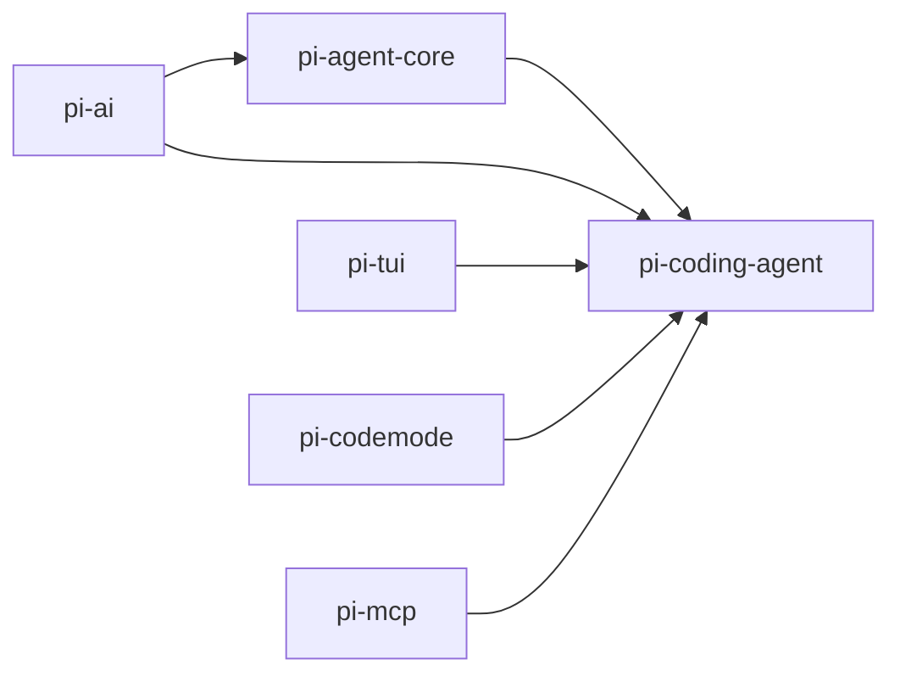

# 第 11 章 源码导读与进阶路线

[← 上一章](10-automation.md) · [目录](README.md)

> **本章你将学会**：在 monorepo 中定位核心包；追踪一次请求从 CLI 到模型再到工具的代码路径；读懂会话条目与上下文组装；按正确顺序阅读源码；运行构建、检查和测试；找到继续深入的方向。
>
> **对应官方文档**：[How Pi Works](https://pi.dev/docs/latest/how-pi-works) · [Session File Format](https://pi.dev/docs/latest/session-format) · [Message Types](https://pi.dev/docs/latest/message-types)

## 11.1 monorepo 地图

Pi 仓库按包拆分，每个包有独立职责：

| 包 | 职责 | 与入门的关系 |
|---|---|---|
| `packages/tui` | 终端 UI 库：差分渲染、编辑器、组件、图片 | 第 3、9 章 |
| `packages/ai` | 多提供商模型 API、流式事件、模型目录、认证 | 第 4、10 章 |
| `packages/agent` | 智能体循环、工具调用、状态与事件类型 | 第 1、10 章 |
| `packages/coding-agent` | 编程智能体 CLI：会话、工具、资源、扩展、模式 | 全书核心 |
| `packages/codemode` | QuickJS 沙箱与工具调用运行时 | 第 8 章 |
| `packages/mcp` | 独立的 MCP 客户端 | 第 8 章 |
| `packages/durable` | 持久化对话、任务、文档运行时 | 进阶 |
| `packages/chord` | 可热重载插件、契约、复制状态、跨 JSON 链接的 RPC | 进阶 |
| `packages/telemetry` | 厂商中立的遥测契约与适配器 | 进阶 |

依赖方向大体是 `coding-agent` 依赖 `agent`、`ai`、`tui`；`agent` 依赖 `ai`；`tui` 相对独立。`durable`、`chord`、`telemetry` 是更底层的运行时，CLI 之外的应用可以直接使用。



箭头表示“被依赖”：`pi-ai` 在底层，`pi-coding-agent` 在顶层。`pi-mcp` 和 `pi-codemode` 也可以被其他应用单独使用。

## 11.2 启动路径

CLI 入口是 `packages/coding-agent/src/cli.ts`：它先调用 `setupCli()` 设置进程标记和 HTTP dispatcher，再把参数转交给 `src/main.ts`。`main.ts` 做这些事：

1. 用 `src/cli/args.ts` 解析参数，生成 `Args`。
2. 处理子命令（`install`、`update`、`config`、`auth`、`mcp` 等）。
3. 读取管道输入、`@file` 参数和初始消息。
4. 解析项目信任，加载设置与资源。
5. 选择会话文件，构造 `SessionManager`。
6. 通过 `src/core/agent-session-services.ts` 创建服务，再创建 `AgentSession`。
7. 按模式进入交互、打印、JSON 或 RPC。

参数解析集中在 `args.ts`，因此 `pi --help` 的输出和实际行为都从这里来。扩展可以通过 `pi.registerFlag()` 增加长选项；未知短选项会被拒绝。

> 源码位置：`packages/coding-agent/src/main.ts`（启动编排）、`packages/coding-agent/src/cli/args.ts`（参数定义与帮助）。

## 11.3 一次请求的代码路径

以交互模式输入一条提示词为例。下表中的 `src/...` 均指 `packages/coding-agent/src/...`：

| 阶段 | 代码位置 |
|---|---|
| 编辑器提交输入 | `src/modes/interactive/interactive-mode.ts` |
| 会话接收提示词 | `src/core/agent-session.ts` 的 `prompt()` |
| 处理扩展命令、技能、模板 | `prompt()` 内部与 `src/core/prompt-templates.ts`、`skills.ts` |
| 组装系统提示词 | `src/core/system-prompt.ts` |
| 组装活动分支与工具 | `src/core/session-manager.ts`、`src/core/tools/` |
| 运行智能体循环 | `packages/agent/src/agent-loop.ts` |
| 调用提供商 | `packages/ai/src/api/` 与 `packages/ai/src/providers/` |
| 执行工具 | `packages/agent/src/agent-loop.ts` 的工具执行段，工具实现在 `src/core/tools/` |
| 记录条目 | `src/core/session-manager.ts` |
| 渲染事件 | `src/modes/interactive/`、`src/modes/json-event.ts`、`src/modes/rpc/rpc-mode.ts` |

`AgentSession` 是中枢：它持有会话、模型、工具集、消息队列、压缩状态和扩展运行时。`agentLoop()` 只负责“请求模型 → 执行工具 → 继续”的循环，不关心终端或会话文件。`pi-ai` 只负责把统一请求翻译成各提供商的协议，并把流式响应翻译成统一事件。`SessionManager` 只负责条目树和上下文重建。这种分层让五种接口可以共用同一套行为。

工具调用默认并行执行。会修改文件的工具通过 `withFileMutationQueue()` 接入逐文件队列，避免同一回合内两个工具读取同一份旧内容、各自计算修改、后写覆盖先写。内置 `edit` 和 `write` 已经在队列中；自定义工具若修改文件，也应使用同一个队列。

## 11.4 会话存储与上下文重建

会话文件是 JSONL。第一行是 `session` 头，之后每个条目都有 `type`、`id`、`parentId` 和 ISO 时间戳。常见类型：

| 类型 | 作用 |
|---|---|
| `message` | 用户、助手、工具结果、系统消息 |
| `model_change` | 模型切换 |
| `thinking_level_change` | 思考等级切换 |
| `compaction` | 上下文压缩摘要与保留边界 |
| `branch_summary` | 分支摘要 |
| `custom` | 扩展状态，不进入模型上下文 |
| `custom_message` | 扩展注入的消息，进入模型上下文 |
| `label` | 会话树书签 |
| `session_info` | 会话名称 |
| `usage` | 模型归属的用量记录，不进入上下文 |

会话版本从 v1 的线性序列，演进到 v2 的 `id`/`parentId` 树，再到 v3 统一 `custom` 角色。加载旧会话时自动迁移。

上下文重建的核心是 `SessionManager.buildContextEntries()`：

1. 从当前叶子向根走，收集活动路径上的条目。
2. 如果路径上有多条压缩条目，取最新一条。
3. 先放压缩条目，再放从 `firstKeptEntryId` 到压缩条目前（不含）的非系统条目，最后放压缩条目之后的条目。
4. 保留非消息条目，供界面渲染。

之后 `buildSessionContext()` 把条目转换成模型消息：`message` 直接使用；`compaction` 生成“系统检查点 + 压缩摘要”；`branch_summary` 生成分支摘要；`custom_message` 生成自定义消息；`usage` 和 `custom` 不产生上下文消息。

`context_edit` 是另一种机制：它追加一条编辑，指向较早的上下文条目，可以省略该条目或替换其内容。原始条目和导出不变，只有未来的模型上下文受影响。压缩恢复会用它来省略被放弃的尝试。

一个最小的消息条目：

```json
{"type":"message","id":"b2c3d4e5","parentId":"a1b2c3d4","timestamp":"2024-12-03T14:00:02.000Z","message":{"role":"assistant","content":[{"type":"text","text":"Hi!"}],"api":"anthropic-messages","provider":"anthropic","model":"claude-sonnet-4-5","usage":{"input":100,"output":10},"stopReason":"stop","timestamp":1733234402000}}
```

条目时间戳是 ISO 字符串，消息内部的时间戳是 Unix 毫秒。助手消息记录提供商、模型、用量和停止原因；这些字段让恢复会话和统计费用不需要重新调用模型。

> 源码位置：`packages/coding-agent/src/core/session-manager.ts`（`buildContextEntries()`、`buildSessionContext()`、条目类型）、`packages/coding-agent/src/core/compaction/compaction.ts`（压缩与恢复）。

## 11.5 系统提示词与工具装配

系统提示词不是一段固定字符串，而是按名称分节的结构化对象。`src/core/system-prompt.ts` 负责：

- `preamble`：基础身份说明，或 `--system-prompt`/`SYSTEM.md` 提供的替换文本；
- `tools`：当前声明工具的一行说明；
- `rules`：工具规则、`promptGuidelines`、内置通用规则；
- `docs`：Pi 自身文档的位置提示；
- `addendum`：`APPEND_SYSTEM.md` 或 `--append-system-prompt`；
- `project_context`：`AGENTS.md` 等上下文文件；
- `skills`：技能的 name、description、路径；
- `cwd`：当前工作目录；
- 自定义节：扩展通过 `before_agent_start` 的 `systemPromptOptions.sections` 添加。

每个非 `preamble` 节会被同名 XML 标签包裹，例如 `<project_context>…</project_context>`。这样做的好处是扩展修改某一节后，Pi 可以只把变化的节作为系统消息补丁追加，而不必重发整段提示词，从而保留提示缓存。

工具声明来自当前启用的工具定义：名称、描述、TypeBox 参数 schema。`promptSnippet` 决定是否出现在 `tools` 节，`promptGuidelines` 决定是否向 `rules` 节添加条目。`defaultActive: false` 的工具注册但不启用；`pi.setActiveTools()` 可以在运行时改变集合。

技能只在系统提示词中放索引，正文由模型按需读取。这是上下文成本控制的关键：技能再多，也不会把全部说明一次性塞进每次请求。

系统提示词的文本大致呈这种结构（节选）：

```text
You are an expert coding assistant operating inside pi...

<tools>
- read: Read file contents
- bash: Execute bash commands...
</tools>

<rules>
- Use read to examine files instead of cat or sed.
- Be concise in your responses
</rules>

<project_context>
<project_instructions path="/path/to/project/AGENTS.md">
...
</project_instructions>
</project_context>

<cwd>
/path/to/project
</cwd>
```

节名和顺序由 `buildSystemPromptSections()` 决定；扩展可以添加自定义节，或修改 `selectedTools`、`promptGuidelines`。修改某一节后，Pi 会生成只包含变化节的系统消息补丁，而不是重发整段提示词。

## 11.6 扩展运行时

扩展加载分几步：

1. `src/core/extensions/loader.ts` 发现扩展文件：自动目录、设置中的路径、`-e` 参数、Pi 包。
2. `jiti-loader.ts` 用 jiti 直接加载 TypeScript，不需要预编译。
3. 扩展工厂接收 `ExtensionAPI`，注册事件、工具、命令、快捷键、参数、提供商等。
4. `src/core/extensions/runner.ts` 持有注册表，按加载顺序和注册顺序分发事件。
5. `AgentSession.bindExtensions()` 把会话上下文、UI、模型注册表等能力绑定给扩展。

异步工厂会在 `session_start` 前完成，因此适合一次性初始化。工厂可能在未启动会话的调用中运行，所以后台资源应推迟到 `session_start`，并在 `session_shutdown` 清理。

扩展事件与智能体事件是两层：`tool_call`、`tool_result` 等由扩展运行时拦截；`turn_start`、`agent_end` 等由智能体循环产生。`AgentSession` 把两层事件合并成对外的会话事件。

## 11.7 四种 CLI 模式的共用与差异

| 模式 | 入口 | 输入 | 输出 |
|---|---|---|---|
| 交互 | `modes/interactive/interactive-mode.ts` | 终端编辑器 | TUI 渲染 |
| 打印 | `modes/print-mode.ts` | 提示词/管道 | 最终文本 |
| JSON | `modes/json-event.ts` | 提示词 | JSONL 事件 |
| RPC | `modes/rpc/rpc-mode.ts` | JSONL 命令 | 响应与事件 |

四者都创建或复用一个 `AgentSession`，都消费同一套会话事件。差异只在输入解析、输出序列化和生命周期。因此排查行为问题时，先判断问题属于“核心会话”还是“某个模式的适配层”：如果打印模式和交互模式表现不同，问题通常在模式层；如果两者都错，回到 `AgentSession`、智能体循环或工具实现。

## 11.8 构建、检查与测试

在仓库根目录：

```bash
npm install --ignore-scripts
npm run build
npm run check
./test.sh
./pi-test.sh
```

- `npm install --ignore-scripts` 安装依赖但不运行生命周期脚本。
- `npm run build` 刷新模型数据并构建所有包；`npm run build:offline` 使用已有模型数据离线构建。
- `npm run check` 运行 lint、格式和类型检查，不运行测试。
- `./test.sh` 运行不依赖真实模型的测试；没有 API Key 时会跳过依赖 LLM 的测试。
- `./pi-test.sh` 从源码运行 Pi，可以在任意目录执行。

测试单个文件时，从包根目录运行 Vitest 或 `node --test`，具体命令见仓库 `AGENTS.md`。不要直接运行完整的 `npm test` 或全量 Vitest，因为其中包含在特定环境变量存在时才激活的端到端测试。

调试运行时：

- `/debug` 把渲染行和当前会话消息写入 agent 目录下的 `pi-debug.log`。
- 崩溃日志、设置诊断和扩展加载错误会在启动时报告。
- 用 `pi -ne` 禁用扩展，判断问题是否由扩展引起。
- 用 `pi --no-context-files` 排除 `AGENTS.md` 的影响。

## 11.9 建议的阅读顺序

第一次读源码，按“从行为到实现”的顺序：

1. `packages/agent/src/agent-loop.ts`：先看循环如何请求模型、执行工具、处理事件。
2. `src/core/agent-session.ts`：看会话如何接收提示词、排队消息、绑定扩展。
3. `src/core/session-manager.ts`：看条目树、活动分支和上下文重建。
4. `src/core/system-prompt.ts`：看提示词分节与工具、技能、上下文文件的装配。
5. `src/core/tools/`：从 `read.ts`、`bash.ts`、`edit.ts` 看工具定义和结果结构。
6. `src/core/extensions/loader.ts`、`runner.ts`、`types.ts`：看扩展如何加载和分发事件。
7. `src/modes/`：看四种 CLI 模式如何消费同一套事件。
8. `packages/ai/src/api/`、`providers/`：需要排查提供商协议时再深入。
9. `packages/tui/src/`：需要写自定义 TUI 组件时再读。

不要一开始读 `models.generated.ts` 或生成产物；它们是数据，不是逻辑。也不要在没有具体问题时通读全部源码，先带着一个可验证的问题读。

几个常见阅读陷阱：

- **把会话文件当上下文。** 会话文件包含所有分支和原始条目；模型上下文是活动分支加压缩后的投影。
- **把 `agent_end` 当结束。** 自动重试、压缩恢复和排队消息会让 Pi 继续运行。
- **把工具结果类型当成随便的 JSON。** `details` 被界面和会话逻辑依赖，覆盖内置工具时必须匹配原形状。
- **把扩展当成“外部进程”。** 扩展在 Pi 进程内运行，拥有相同权限，可以读取凭据和会话历史。
- **把系统提示词当固定字符串。** 它是分节组装、可被扩展修改的结构化对象。

## 11.10 进阶方向

- **自定义提供商**：当服务需要自定义认证、动态模型发现或非标准流式协议时，读 `docs/custom-provider.md` 和 `src/core/provider-composer.ts`。
- **虚拟模型**：按任务、费用或对话状态路由请求，读 `docs/virtual-models.md` 和 `src/core/virtual-models.ts`；示例见 `examples/extensions/jev-router.ts`。
- **Codemode 与工具搜索**：读 `src/extensions/codemode/`、`tool-search/`，理解 QuickJS 沙箱和工具暴露。
- **TUI 组件**：读 `docs/tui.md` 和 `packages/tui/src/components/`，为扩展写自定义渲染。
- **Chord 与 Durable**：需要可热重载插件、复制状态或持久化任务运行时，读对应包的文档和测试示例。
- **遥测**：需要接入自己的观测系统时，读 `packages/telemetry`。

## 11.11 一次排查示例

现象：执行 `/compact` 后，`/session` 显示的上下文用量下降，但会话文件大小几乎没变。

排查路径：

1. **确认预期。** 压缩会追加一条 `compaction` 条目，原始消息不会删除，所以文件变大而不是变小是正常的。真正应该下降的是下一次请求的上下文 token。
2. **检查压缩条目。** 用 `jq 'select(.type=="compaction")'` 查看 `firstKeptEntryId` 和 `tokensBefore`。如果 `firstKeptEntryId` 指向很靠后的条目，保留的内容太少；如果指向很靠前的条目，压缩可能没有覆盖多少历史。
3. **检查活动分支。** `buildContextEntries()` 只处理当前叶子到根的路径。压缩条目如果不在活动分支上，不会影响当前上下文。
4. **检查上下文编辑。** `context_edit` 可能省略或替换了某些条目；用 `jq 'select(.type=="context_edit")'` 查看目标。
5. **检查模型窗口。** 状态栏的百分比基于当前模型声明的上下文窗口；切换模型后，同样的 token 数可能显示不同百分比。
6. **检查工具输出。** 压缩后如果马上又读取了大文件，上下文会迅速回升；`/session` 的消息数和 token 数可能不同步。

这个例子说明：源码阅读要和可观察证据结合。先确认“文件大小”“上下文用量”“模型窗口”分别指什么，再决定去读 `session-manager.ts`、`compaction.ts` 还是 `agent-session.ts`。

## 11.12 小结

- monorepo 按 `tui`、`ai`、`agent`、`coding-agent` 分层，CLI 是 `coding-agent` 的入口；一次请求经过 `main.ts`、`AgentSession`、`agent-loop`、`pi-ai`、工具实现，再回到会话与界面。
- 会话是条目树，活动分支和压缩决定模型上下文。
- 系统提示词按节组织，扩展可以只补丁变化的节。
- 扩展由 loader 发现、jiti 加载、runner 分发事件。
- 四种 CLI 模式共用 `AgentSession`，SDK 复用同一内核，差异在输入输出适配层。
- 按“循环 → 会话 → 存储 → 提示词 → 工具 → 扩展 → 模式”的顺序阅读源码。

## 练习

1. 在源码中找到 `pi --continue` 最终打开会话文件的调用链，写出经过的文件和函数。验收：能从 `main.ts` 追到 `SessionManager` 的打开逻辑。
2. 找到 `buildContextEntries()`，用一个真实会话文件验证压缩前后的上下文条目数量。验收：能解释 `firstKeptEntryId` 如何改变结果。
3. 找到 `registerTool()` 的类型定义，列出 `execute` 的参数和返回值字段。验收：与第 9 章的示例一致。
4. 在 `agent-loop.ts` 中找到工具执行的位置，说明并行执行和顺序执行分别由什么控制。验收：能指出 `executionMode` 和逐文件队列的作用点。
5. 从源码运行 Pi（`./pi-test.sh`），加载一个扩展并触发 `session_start`。验收：能确认运行的是源码而不是全局安装版本。
6. 选一个你关心的行为（例如 `/share` 的目的地选择），从文档追到源码，写出完整路径。验收：路径中的文件、函数和配置键都能在仓库中找到。

## 延伸阅读

- [官方文档：How Pi Works](https://pi.dev/docs/latest/how-pi-works)
- [官方文档：Session File Format](https://pi.dev/docs/latest/session-format)
- [官方文档：Message Types](https://pi.dev/docs/latest/message-types)
- [官方文档：Extensions](https://pi.dev/docs/latest/extensions)
- [官方文档：TUI](https://pi.dev/docs/latest/tui)
- 源码：`packages/agent/src/agent-loop.ts`、`packages/coding-agent/src/core/agent-session.ts`、`core/session-manager.ts`、`core/system-prompt.ts`、`core/extensions/`、`modes/`

---

[目录](README.md) · [下一章 →](appendix-a-reference.md)
